#  {background-image="images/90985051_3160362750661404_9121786830419656704_o.jpg" style="text-align: center;"}

<head>

<body>

<h2 style="text-align:center;font-size: 32px;color:white; text-align:center;">

::: {style="background-color: rgba(0, 0, 0, .55); backdrop-filter: blur(6px); box-shadow: 0 0 1.5rem 0 rgba(0, 0, 0, .6); border-radius: 8px; padding: 18px;"}
Architecture of stability: 15 years of pollinator sharing reveal a role of stable core species

<div style="font-size: 19px; font-weight: normal; margin-top: 12px; line-height: 1.45; color: #E8E8E8;">
**Jakub Štenc**^1,2,3^, Sailee P. Sakhalkar^4^, Jiří Hadrava^2^, Michael Mikát^2^, Eva Matoušková^1^, Helena Pijálková^2^, Tadeáš Ryšan^2,5^, Petr Švanda^1,2^, Martin Freudenfeld^1^, Eva Horčičková^6^, Zdeněk Janovský^7^, Jakub Straka^2^, Jordi Bosch^3^
</div>

<div style="font-size: 15px; font-weight: normal; margin-top: 8px; color: #CCCCCC;">
^1^Charles University (Botany) | ^2^Charles University (Zoology) | ^3^CREAF, Spain
</div>
:::

</h2>

{.absolute bottom="0%" left="0" width="230"}

{.absolute bottom="8%" left="0%" width="170"} 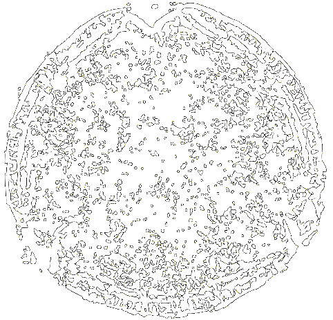{.absolute bottom="8%" right="0%" width="170"}

</body>

</html>

##  {background-video="images/video_intro_reduced_shorter.mp4" background-video-loop="true" background-video-muted="true"}

::: notes
Atmospheric introduction to the Handrkov meadow:
Species-rich submontane grassland ecosystem where dozens of entomophilous plants bloom simultaneously, all sharing a finite pool of flower visitors.
:::

## The Paradox of Pollinator Sharing

::: r-stack
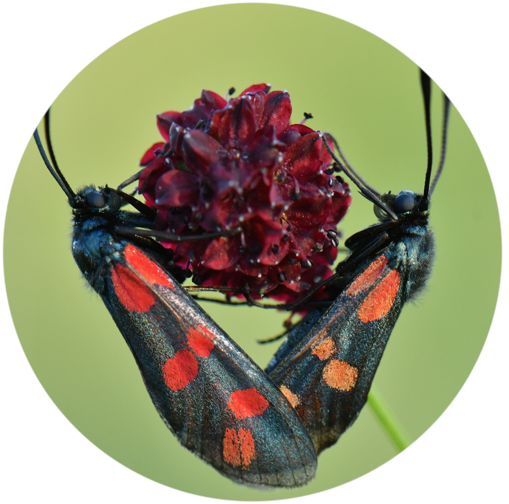{fig-align="center" width="620"}

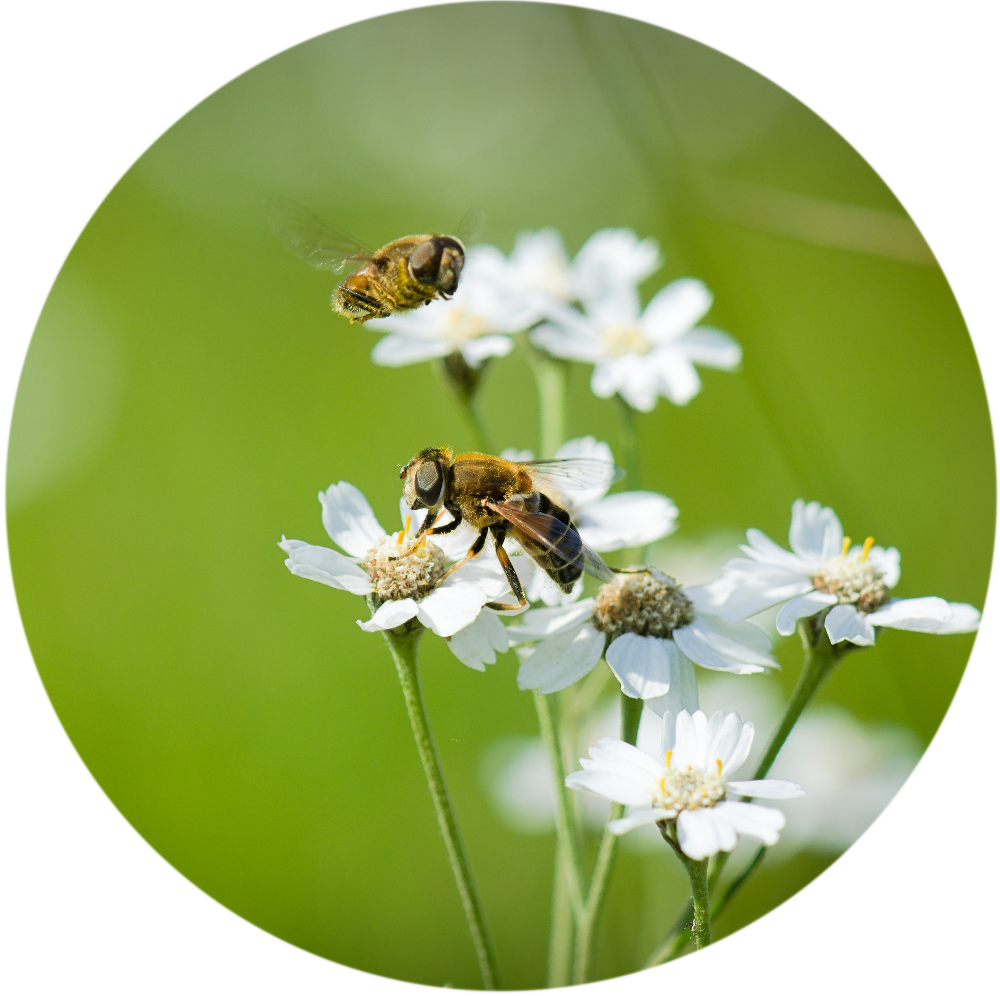{.fragment fig-align="center" width="625"}

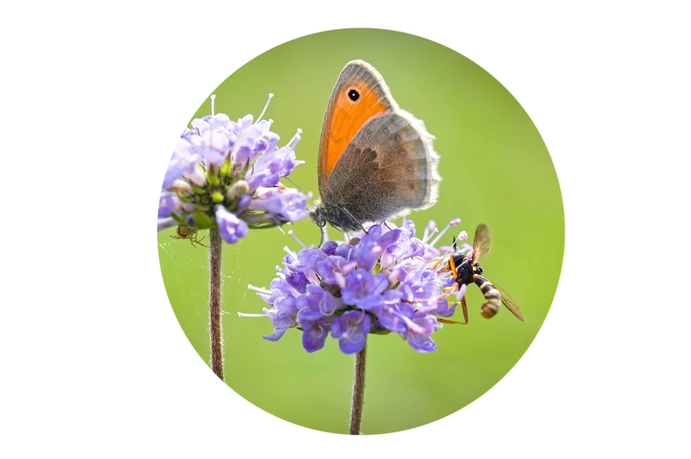{.fragment fig-align="center" width="630"}
:::

::: notes
Start with pollination biology: In species-rich meadows, pollinators are a shared, limiting mutualistic service. 
Co-flowering plants do not interact in isolation; sharing insect visitors mediates indirect interactions—both facilitation (magnet plants) and competition (heterospecific pollen deposition, stigma clogging, pollen dilution).
The paradox: Short-term network studies show massive year-to-year turnover and rewiring. Yet, diverse plant communities persist for decades. 
Is this sharing web in constant chaotic drift, or does an underlying stable architecture anchor the community?
:::

## From Bipartite Visits to Pollinator Sharing

::::: columns
::: {.column width="48%"}
### Bipartite Interaction Network
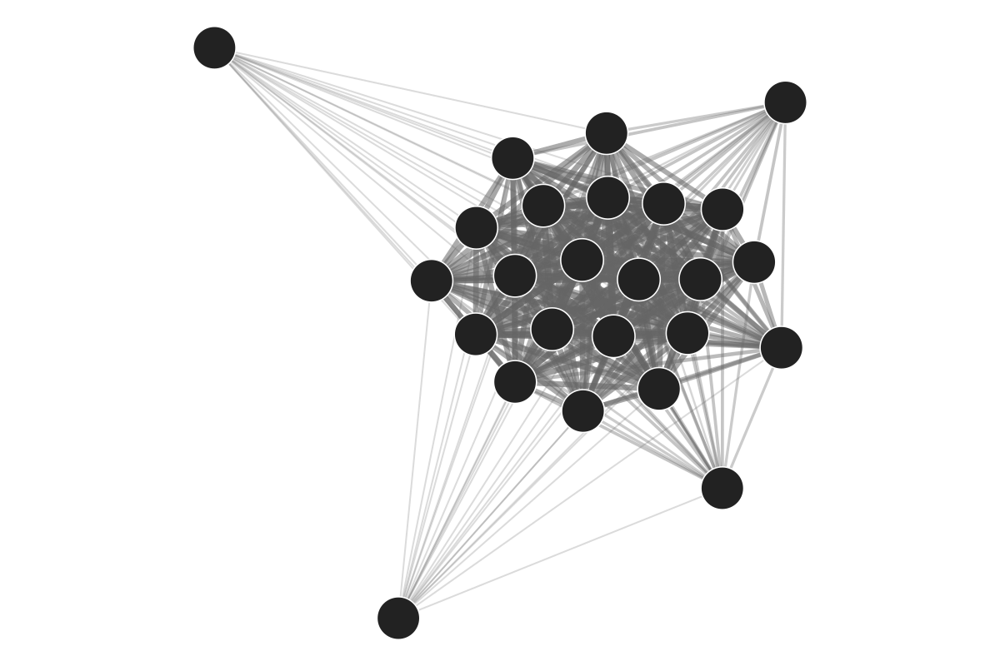{.nostretch width="100%" height="380px" style="object-fit: contain;"}

::: {style="font-size: 18px; color: #555; text-align: center;"}
Direct plant-pollinator links (bipartite visits)
:::
:::

::: {.column width="48%"}
### Pollinator-Sharing Web (PAC)
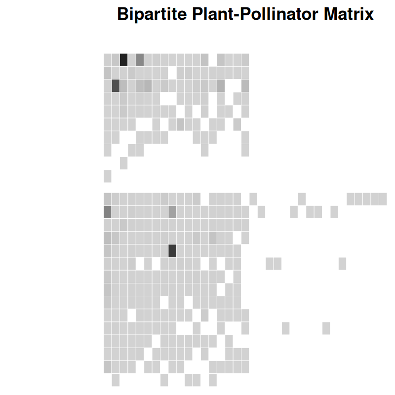{.nostretch width="100%" height="380px" style="object-fit: contain;"}

::: {style="font-size: 18px; color: #555; text-align: center;"}
Müller's index of Pollinator Abundance & Constancy: directed interspecific plant–plant dependence
:::
:::
:::::

::: notes
To examine apparent competition and structural reliance, we construct unipartite plant-plant networks using Müller's PAC index. PAC measures the directed dependency between plants: how much pollinators visiting Target Plant B depend on Floral Donor Plant A.
:::

## Network Architecture: Airports vs. The Meadow {style="margin-top: -12px; margin-bottom: 4px;"}

::::: columns
::: {.column width="49.5%"}
::: {.fragment fragment-index=1 style="text-align: center; font-weight: bold; color: #1E3A8A; font-size: 21px; margin-bottom: 4px;"}
✈️ European Aviation Network
:::

::: r-stack
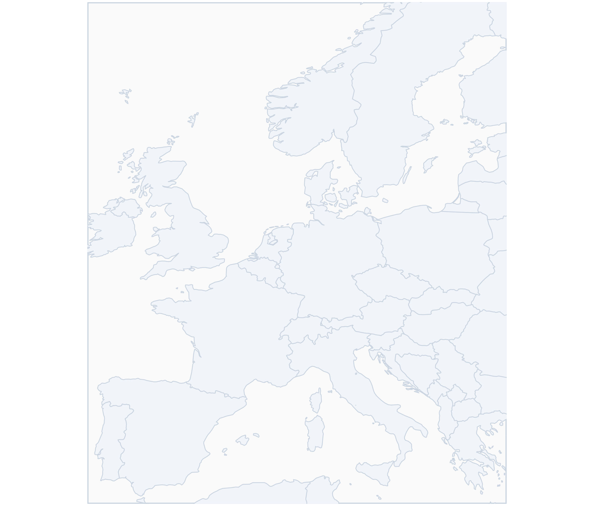{.fragment .fade-in-then-out fragment-index=1 height="485px" fig-align="center"}

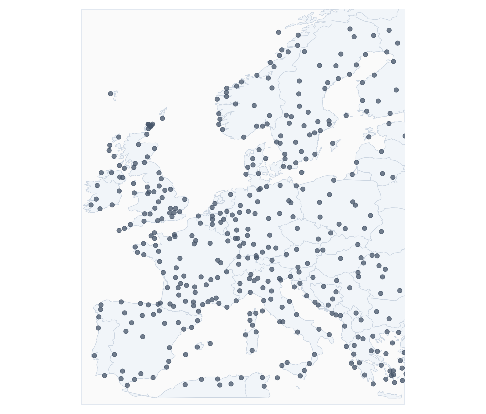{.fragment .fade-in-then-out fragment-index=2 height="485px" fig-align="center"}

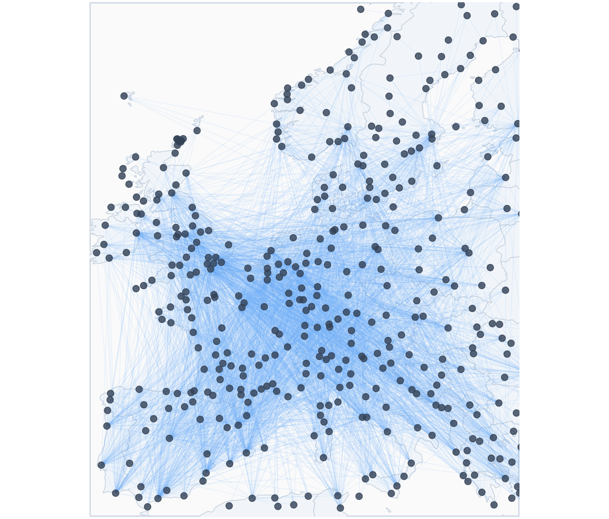{.fragment .fade-in-then-out fragment-index=3 height="485px" fig-align="center"}

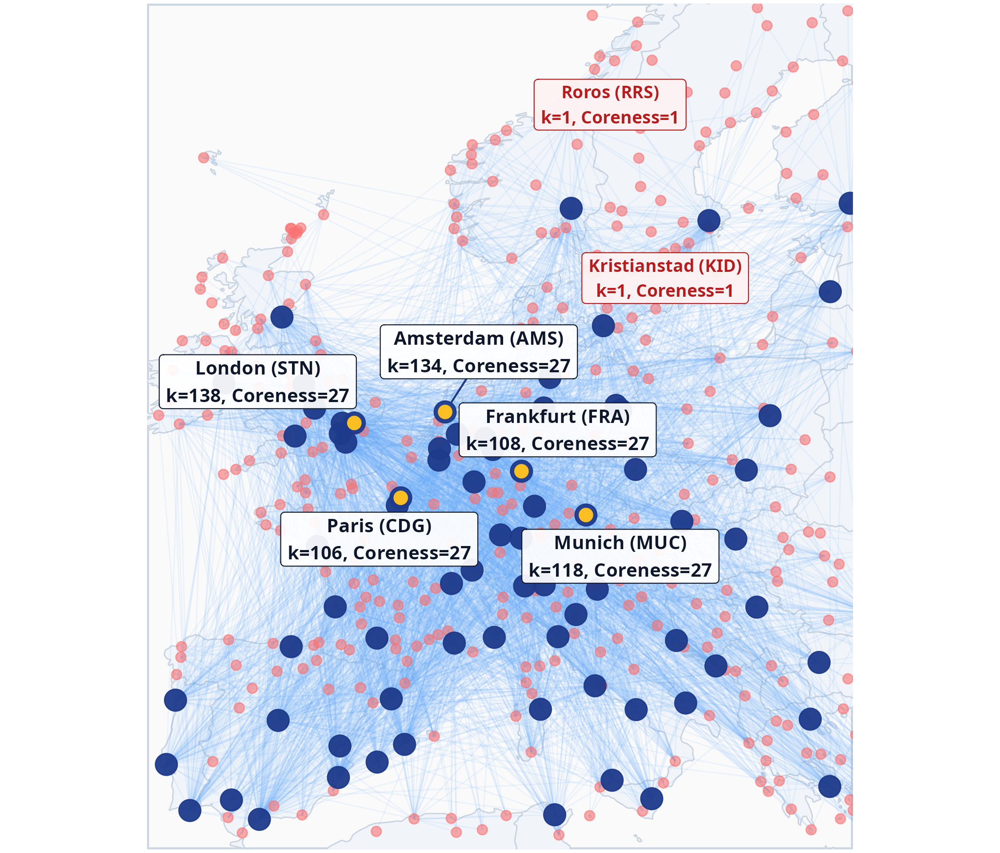{.fragment .fade-in fragment-index=4 height="485px" fig-align="center"}
:::
:::

::: {.column width="49.5%"}
::: {.fragment fragment-index=5 style="text-align: center; font-weight: bold; color: #1E3A8A; font-size: 21px; margin-bottom: 4px;"}
🌸 Meadow Pollinator Sharing
:::

::: r-stack
{.fragment .fade-in-then-out fragment-index=5 height="485px" fig-align="center"}

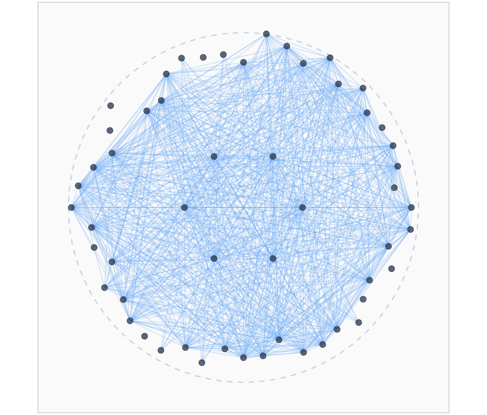{.fragment .fade-in-then-out fragment-index=6 height="485px" fig-align="center"}

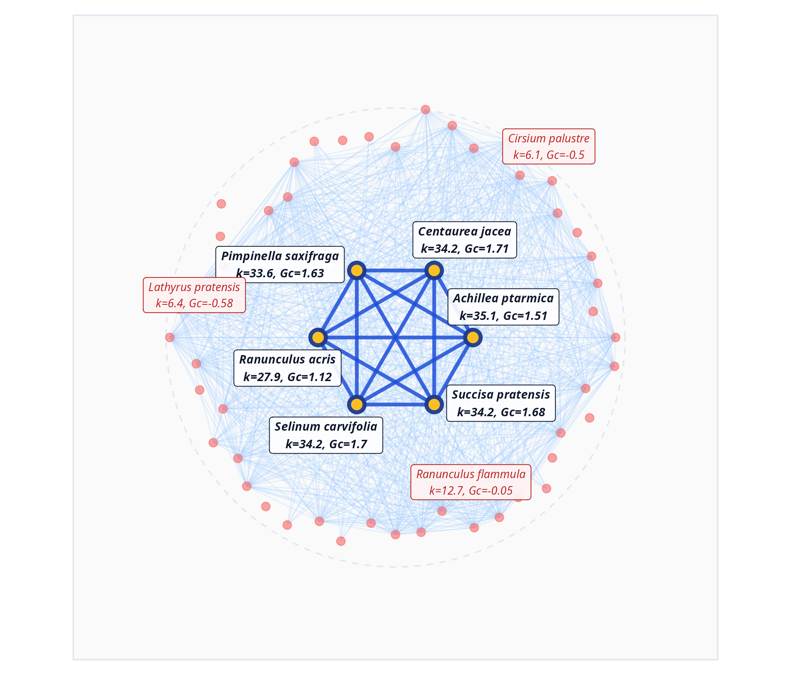{.fragment .fade-in fragment-index=7 height="485px" fig-align="center"}
:::
:::
:::::

::: {.fragment fragment-index=7 style="background-color: #F0F4FA; border-left: 5px solid #1D2D6B; padding: 5px 14px; border-radius: 6px; font-size: 15px; margin-top: 4px; line-height: 1.32; text-align: left;"}
**Shared Topology:** Replace airports with plant species, and flight routes with shared pollinators. Just **6 perennial plant species** act as the meadow's "Heathrows" ($k \approx 34, G_c > 1.1$), anchoring >60% of floral visitor traffic.
:::

::: notes
Step 0 (Title only): To understand the stability of our pollination web, let's step outside ecology and look at an analogy from human infrastructure: the European aviation network.
Step 1 (Map): Here is European airspace.
Step 2 (Airports): Across Europe are 895 airports—geographically scattered, seemingly uniform.
Step 3 (Routes): Add 15,000 empirical commercial flight routes—a complex topological web appears.
Step 4 (Airport Coreness): Calculate coreness: a tiny core of mega-hubs (London, Amsterdam, Frankfurt, Paris) anchors continental travel, while regional airfields (Røros, Kristianstad) are peripheral spokes.
Step 5 (Plant Nodes): Now look at our meadow: 57 co-flowering plant species in Handrkov.
Step 6 (Plant Routes): Add empirical pollinator sharing: visitors link plants together through shared service.
Step 7 (Plant Coreness): The exact same architecture emerges! Just 6 core perennial species form the central routing core, while peripheral flora connect through them.
:::

## What is Robustness? The Extinction Cascade {style="margin-top: -12px; margin-bottom: 4px;"}

::::: columns
::: {.column width="45%"}
::: r-stack
{.fragment .fade-in-then-out fragment-index=1 height="450px" fig-align="center"}

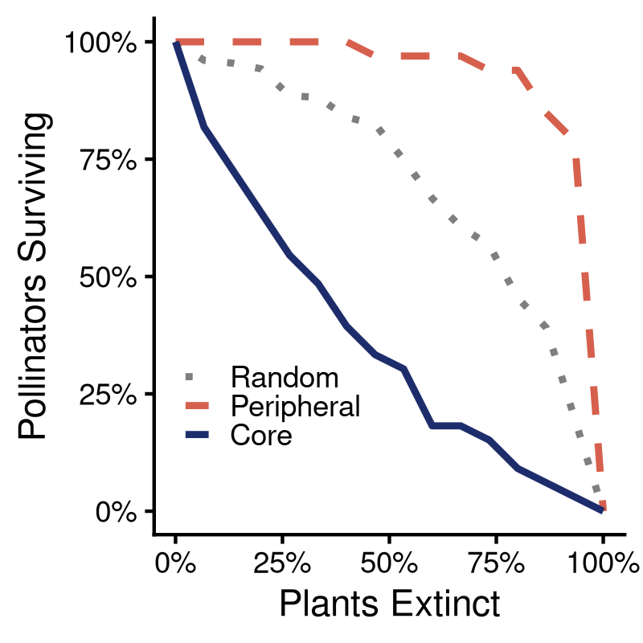{.fragment .fade-in fragment-index=2 height="450px" fig-align="center"}
:::

::: {style="font-size: 15px; text-align: center; color: #64748B; margin-top: 4px;"}
*Co-extinction simulation (Memmott et al. 2004) on Handrkov pollination web*
:::
:::

::: {.column width="53%"}
::: {.fragment fragment-index=1 style="background: linear-gradient(135deg, #F0FDF4 0%, #DCFCE7 100%); border: 2px solid #16A34A; border-radius: 10px; padding: 12px 16px; margin-bottom: 12px; box-shadow: 0 3px 10px rgba(22,163,74,0.12);"}
<div style="display: flex; justify-content: space-between; align-items: center; margin-bottom: 8px;">
  <span style="font-weight: 800; font-size: 20px; color: #166534; letter-spacing: -0.3px;">
    🟢 Peripheral Spoke Loss
  </span>
  <span style="background-color: #16A34A; color: white; font-weight: bold; font-size: 19px; padding: 3px 12px; border-radius: 20px; box-shadow: 0 2px 5px rgba(22,163,74,0.3);">
    $R \approx 0.85$
  </span>
</div>

<div style="display: flex; flex-direction: column; gap: 6px; font-size: 15px; color: #14532D;">
  <div style="background: rgba(255,255,255,0.75); padding: 6px 12px; border-radius: 6px; border-left: 4px solid #16A34A;">
    ✈️ <strong>Aviation:</strong> Regional airfields fail (<em>Røros</em>) ➔ <strong>Continental grid intact</strong>
  </div>
  <div style="background: rgba(255,255,255,0.75); padding: 6px 12px; border-radius: 6px; border-left: 4px solid #16A34A;">
    🌸 <strong>Meadow:</strong> Peripheral flora lost (<em>Lathyrus</em>) ➔ <strong>Pollinators buffered by core</strong>
  </div>
</div>

<div style="margin-top: 6px; font-size: 13px; font-weight: 600; color: #15803D; text-align: right;">
  ✓ High Structural Redundancy • Shock Absorbed
</div>
:::

::: {.fragment fragment-index=2 style="background: linear-gradient(135deg, #FEF2F2 0%, #FEE2E2 100%); border: 2px solid #DC2626; border-radius: 10px; padding: 12px 16px; box-shadow: 0 3px 10px rgba(220,38,38,0.12);"}
<div style="display: flex; justify-content: space-between; align-items: center; margin-bottom: 8px;">
  <span style="font-weight: 800; font-size: 20px; color: #991B1B; letter-spacing: -0.3px;">
    🔴 Core Hub Loss
  </span>
  <span style="background-color: #DC2626; color: white; font-weight: bold; font-size: 19px; padding: 3px 12px; border-radius: 20px; box-shadow: 0 2px 5px rgba(220,38,38,0.3);">
    $R \approx 0.45$
  </span>
</div>

<div style="display: flex; flex-direction: column; gap: 6px; font-size: 15px; color: #7F1D1D;">
  <div style="background: rgba(255,255,255,0.75); padding: 6px 12px; border-radius: 6px; border-left: 4px solid #DC2626;">
    ✈️ <strong>Aviation:</strong> Mega-hubs shut (<em>Heathrow</em>) ➔ <strong>Transit paralyzed</strong>
  </div>
  <div style="background: rgba(255,255,255,0.75); padding: 6px 12px; border-radius: 6px; border-left: 4px solid #DC2626;">
    🌸 <strong>Meadow:</strong> 6 Core Hubs wither (<em>Centaurea</em>) ➔ <strong>Secondary cascades</strong>
  </div>
</div>

<div style="margin-top: 6px; font-size: 13px; font-weight: 600; color: #B91C1C; text-align: right;">
  ⚠ Systemic Vulnerability • The Achilles' Heel
</div>
:::
:::
:::::

::: {.fragment fragment-index=3 style="background-color: #1D2D6B; color: white; padding: 7px 18px; border-radius: 8px; text-align: center; font-size: 18px; margin-top: 6px;"}
**The 15-Year Question:** In Handrkov, did extreme climate warming break our core hubs—or did the core hold?
:::

::: notes
Slide 6: Here is how network theory formalizes robustness (Memmott et al. 2004).
Robustness R is the area under the co-extinction curve: as we remove plant species, how many pollinators survive?
Click 1: When we remove peripheral species first (red dashed curve), the curve stays flat near 100%! Almost all pollinators survive because they have the core. Just like closing a regional airfield in Norway leaves European flights running. Robustness R is high (0.85).
Click 2: BUT when we remove the core hubs first (solid navy curve), the curve drops off a cliff! Losing Centaurea and Succisa deprives pollinators of their main food, causing secondary extinction cascades. Robustness plunges to 0.45!
Click 3: This sets up our central ecological dilemma: Across 15 years, during unprecedented summer droughts, did climate stress break our core hubs, or did the core species buffer the community?
Let's look at the climate history of our meadow!
:::

## Questions

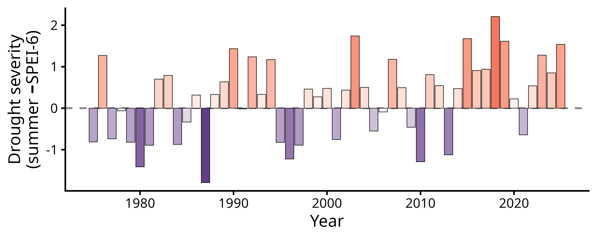{.nostretch width="100%" height="450px" style="object-fit: contain; margin-top: 10px;"}

::: {style="font-size: 18px; text-align: center; color: #888888; margin-top: 5px;"}
*Data: TerraClimate (Abatzoglou et al., 2018), Handrkov locality (1975–2025)*
:::

## Questions

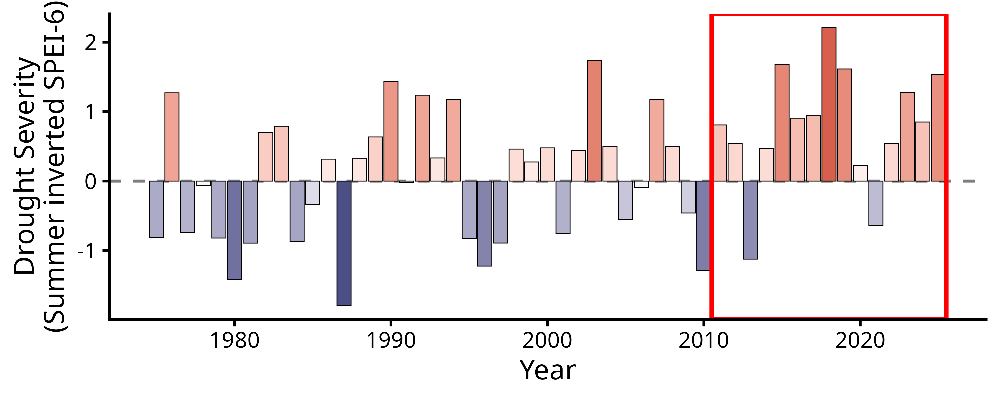{.nostretch width="100%" height="450px" style="object-fit: contain; margin-top: 10px;"}

::: {style="font-size: 18px; text-align: center; color: #888888; margin-top: 5px;"}
*Data: TerraClimate (Abatzoglou et al., 2018), Handrkov locality (1975–2025)*
:::

## Questions

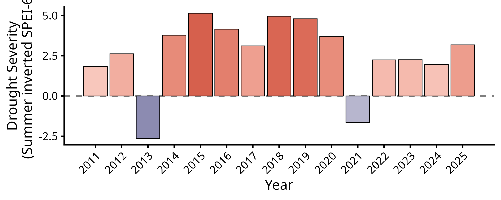{.nostretch width="100%" height="450px" style="object-fit: contain; margin-top: 10px;"}

::: {style="font-size: 18px; text-align: center; color: #888888; margin-top: 5px;"}
*Data: TerraClimate (Abatzoglou et al., 2018), Handrkov locality (2011–2024)*
:::

:::: {.fragment .absolute top="40%" left="10%" width="80%"}
<h2 style="text-align:center;color:white;">

::: {style="background-color: rgba(0, 0, 0, .8); backdrop-filter: blur(5px); box-shadow: 0 0 1rem 0 rgba(0, 0, 0, .5); border-radius: 5px; text-align:center;"}
How does Plant-Pollinator network sustain climatic perturbances?
:::

</h2>
::::

## Methods - the locality

::::: {layout-ncol="2"}
::: fragment
![[Czech Republic]{style="font-size: 32px;"}](images/Picture9.png){width="400"}
:::

::: fragment
![[Rich in flowers]{style="font-size: 32px;"}](images/banner.jpg){width="800"}
:::
:::::

::: {.absolute .fragment bottom="80" right="380"}
-   15 years of data collection (2011-2025)
:::

## Methods - permanent plots

---
fig-cap-location: top
---

```{=html}
<style>
 #slide1 .quarto-title-caption {
  font-size: 22px;
  }
</style>
```

<div>

:::::: {layout="[0.3,  0.3, 0.3]"}
::: {.fragment top="100" height="200"}
![[plots are marked]{style="font-size: 32px;"}](images/Picture3.jpg){width="300"}
:::

::: {.fragment top="100" height="200"}
![[recovered every year]{style="font-size: 32px;"}](images/Picture2.jpg){width="300"}
:::

::: {#sec-column .fragment top="100" height="700"}
![[93 plots in total]{style="font-size: 32px;"}](images/han_map_1.png)
:::
::::::

</div>

## Methods - plant-pollinator survey

<div>

::::: {layout="[0.5, 0.5]"}
::: {.fragment top="70" height="400"}
![[Plant survey]{style="font-size: 32px;"}](images/Picture1.jpg)
:::

::: {.fragment top="70" height="400"}
![[Pollinator survey]{style="font-size: 32px;"}](images/Picture5.jpg)
:::
:::::

</div>

## Methods - plant survey

<div>

:::: {layout="[0.5, 0.5]"}
::: {.fragment top="70" height="400"}

:::

<!-- empty column to create gap -->
::::

</div>

::: {.absolute .fragment top="10%" left="55%"}
-   4 x 4 meter squares
-   Stalks of flowering plants are counted or scored presence/absence in subplots
-   2 times per sampling period
:::

## Methods - pollinator survey

<div>

::::: {layout="[0.5, 0.5]"}
::: {.fragment top="70" height="400"}
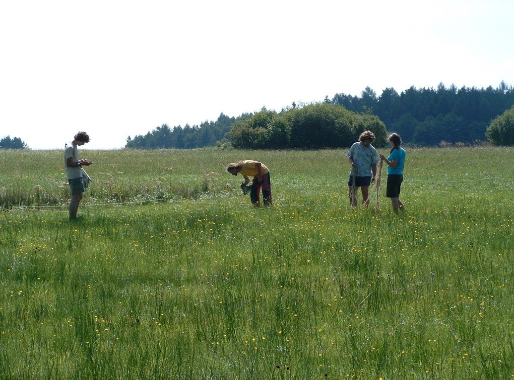
:::

<div>

<!-- empty column to create gap -->

</div>
:::::

</div>

::: {.absolute .fragment top="10%" left="55%"}
-   "Snapshot" of plant-pollinator interaction
-   20+ sampling per plot per year
-   97 629+ interactions recorded
:::

## Methods - plant-pollinator survey

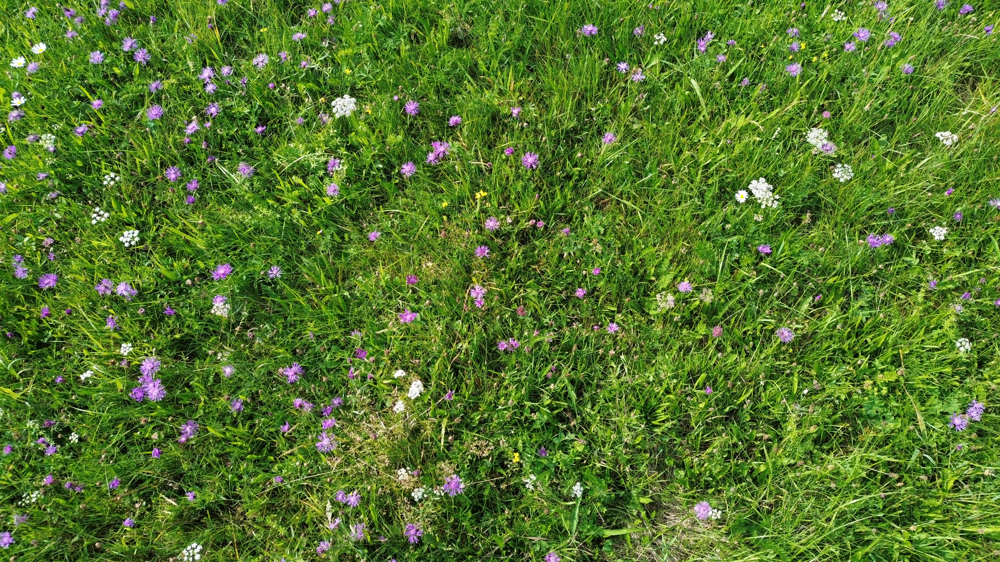

## Methods - plant-pollinator survey

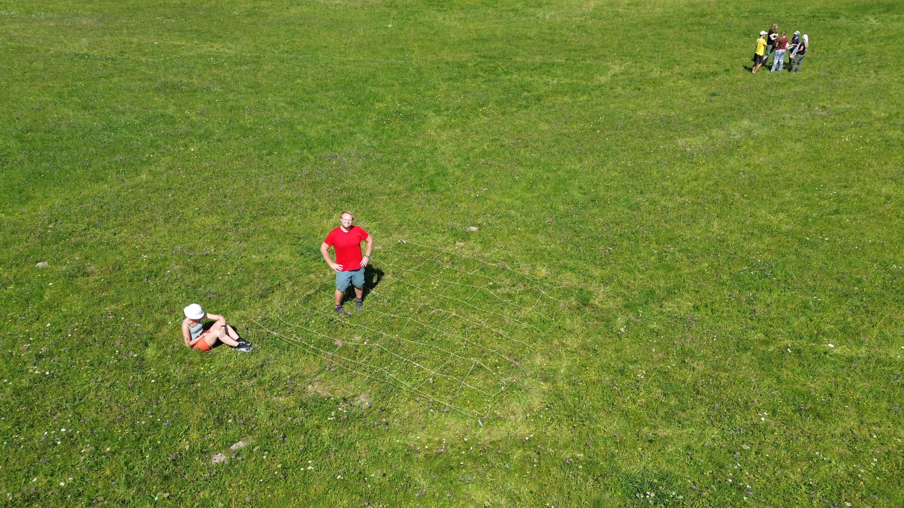

## Methods - plant-pollinator survey

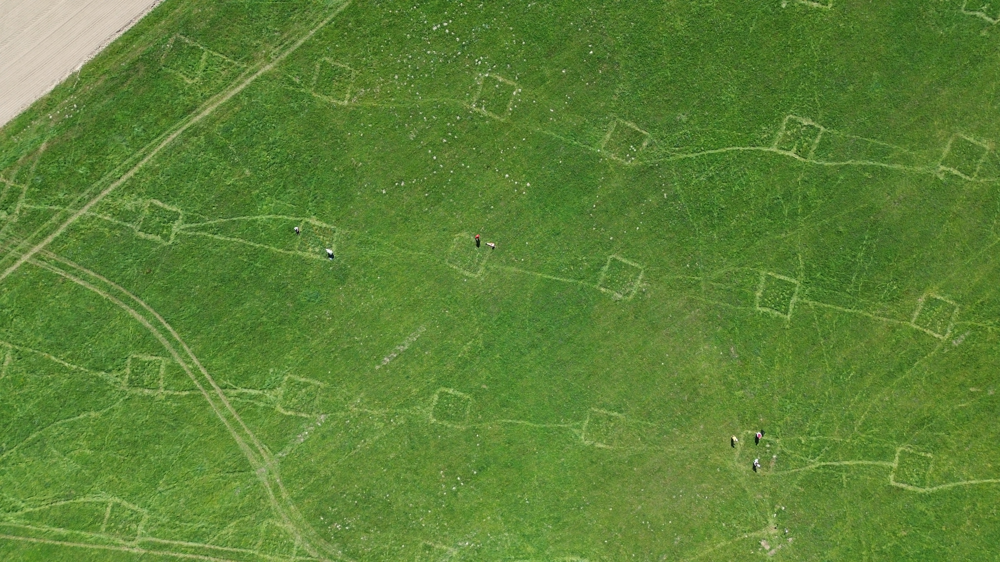

## Methods - plant-pollinator survey

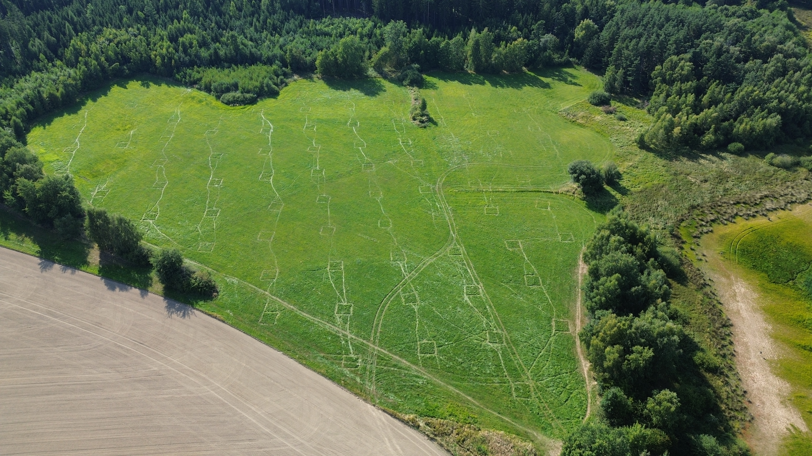

## Networks

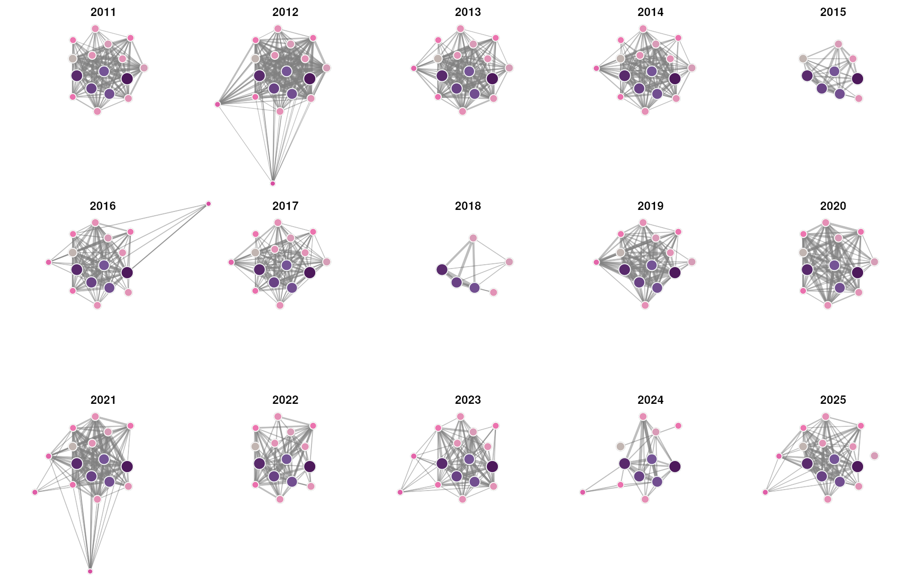{fig-align="center" height="600"}

## Macro-Dynamics: Two Decoupled Timescales

{fig-align="center" height="540"}

::: notes
Non-metric multidimensional scaling (NMDS) of annual directed PAC matrices (Bray-Curtis, stress = 0.106).
Vector fitting identifies two decoupled, orthogonal axes:
1. Axis 1 (Horizontal - Acute Climate Pulse): Summer drought severity (r² = 0.55, p = 0.008) and summer temperature (r² = 0.67, p = 0.001) displace the network during severe droughts (2015 and 2018) far to the right into centralized topological states.
2. Axis 2 (Vertical - Decadal Press): Steady successional progression across 15 years (r² = 0.71, p = 0.0008).
Crucially: Notice the hysteresis! When rainfall returned in 2020-2021, the network shifted back horizontally along Axis 1, but NEVER returned to its pre-2015 baseline along Axis 2.
:::

## Identifying the Meadow's Permanent Hubs

::: {style="background-color: #F8F9FA; border-left: 6px solid #1D2D6B; padding: 26px 30px; border-radius: 8px; box-shadow: 0 4px 12px rgba(0,0,0,0.06); font-size: 24px; line-height: 1.6; margin-top: 60px;"}
::: {style="border-bottom: 1px solid #CBD5E1; padding-bottom: 18px; margin-bottom: 18px;"}
Are the network hubs just an **ephemeral accident** of whoever happens to produce the most flowers in a given year?
:::

Or does the meadow possess a **permanent set of topological anchors** that maintain core roles across 15 years—irrespective of climatic extremes?
:::

::: notes
Recall our airport analogy: is Frankfurt an international hub because it randomly had an extra runway open on a sunny Tuesday? Or because of permanent structural routing?
In pollination networks, the central question is whether network hubs are merely abundant generalists, or whether specific plant identities provide permanent community cohesion.
To test this, we compared every species against a presence-conditional null model across all 15 years.
:::

## Discovering the True Core

{fig-align="center" height="540"}

::: notes
Are network hubs just random flowers that happen to bloom heavily?
We tested each species' 15-year standardized coreness against a conservative, presence-conditional (flowering-only) null model (1,000 perms/yr).
Exactly 6 species maintained statistically significant excess centrality:
Centaurea jacea, Selinum carvifolia, Succisa pratensis, Pimpinella saxifraga, Achillea ptarmica, and Ranunculus acris (all P_adj <= 0.0015).
:::

## Plant Identity Matters: Not an Abundance Lottery!

::::: columns
::: {.column width="50%"}
### The Neutral Hypothesis
- Hubs are just whichever plants produce the most flowers.
- Coreness drifts randomly with plant density.
- Species traits play no role.
:::

::: {.column width="50%"}
### Linear Mixed Model (Centrality)
- **Plant Identity:** explains **38%** of variance
- **Floral Abundance:** explains **44%** of variance
- **LRT for Plant Identity:**  
  $\chi^2 = 328.8, \mathbf{p = 1.8 \times 10^{-73}}$
:::
:::::

<br>

:::: {.fragment .fade-up}
::: {style="background-color: #1D2D6B; color: white; padding: 18px; border-radius: 8px; text-align: center; font-size: 23px;"}
**Pollinators actively seek out core species beyond their sheer floral abundance.**  
The core is an enduring architectural feature grounded in intrinsic floral syndromes and attractiveness.
:::
::::

::: notes
Even after controlling for raw flower count, species identity explains nearly 40% of the variance. 
Topological invariance: In multi-year modularity cartography (Guimerà & Amaral), these exact same 6 species emerge as permanent module hubs (z = 0.86-2.39).
Markov role transitions show core species have a 59.2% probability of remaining hubs year-to-year and a 70.4% rebound probability, compared to only 3.5% for peripherals.
:::

## Secondary Extinctions: The Fragility Flip

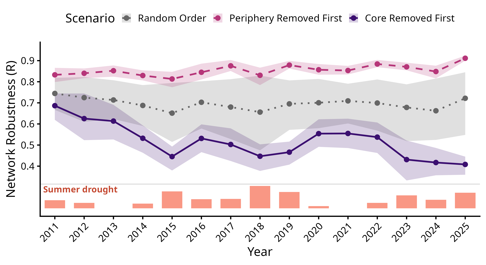{fig-align="center" width="880"}

:::: {.fragment .fade-up}
::: {style="background-color: rgba(29, 45, 107, 0.12); border-left: 6px solid #1D2D6B; padding: 12px; margin-top: 10px; font-size: 21px;"}
**During normal years:** The meadow exhibits high structural redundancy ($R \approx 0.63\text{--}0.84$).  
**During severe droughts (2015, 2018):** Core loss triggers catastrophic collapse ($R \approx 0.45$), while peripheral loss is easily buffered ($R \approx 0.83$). The **Robustness Gap ($\Delta R$)** surges!
:::
::::

::: notes
We simulated secondary extinction cascades (Memmott et al. 2004). Robustness R is the area under the co-extinction curve.
In non-drought years, pollinators easily switch partners. But in 2015 and 2018, the network's survival becomes almost exclusively dependent on the 6 core species.
:::

## What Causes the Flip? A 3-Step Mechanistic Cascade

:::::: columns
::: {.column width="33%"}
#### 1. Vulnerability ($\Delta R$)
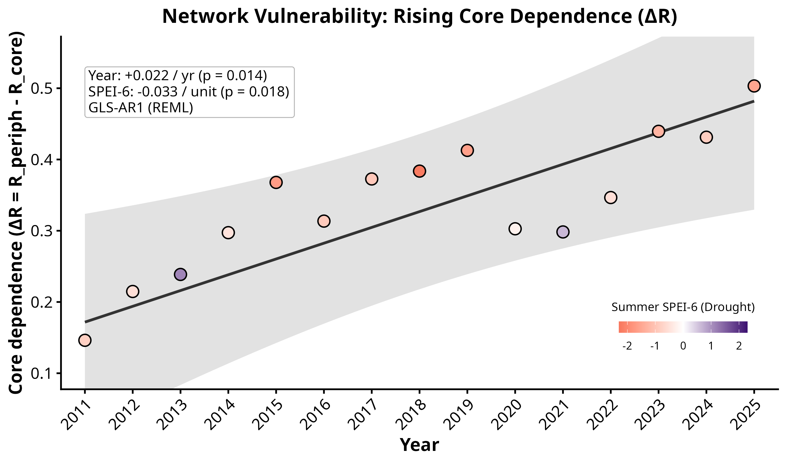{.nostretch width="100%" height="280px" style="object-fit: contain;"}

::: {style="font-size: 15px; color: #444;"}
Core dependence surges during summer droughts ($p = 0.018$) and rises over time ($+0.022/\text{yr}$).
:::
:::

::: {.column width="33%"}
#### 2. Floral Asymmetry
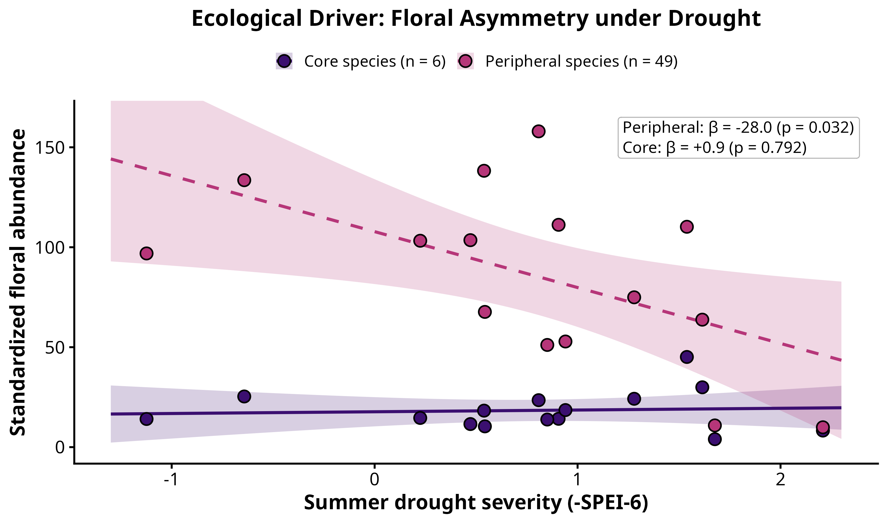{.nostretch width="100%" height="280px" style="object-fit: contain;"}

::: {style="font-size: 15px; color: #444;"}
**Periphery crashes 10-fold** ($\beta = -28.0, p = 0.032$).  
**Core is completely drought-buffered** ($\beta = +0.9, p = 0.792$).
:::
:::

::: {.column width="33%"}
#### 3. Motif Scaffolding
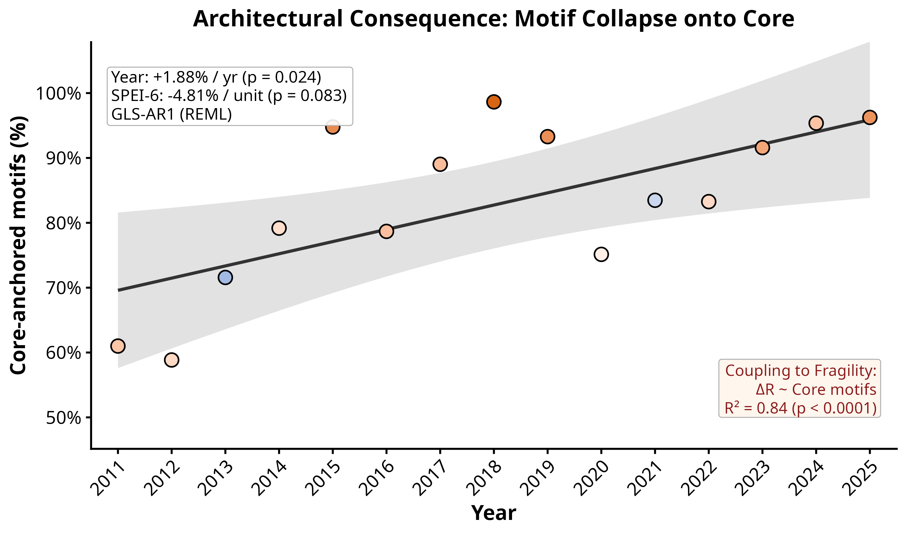{.nostretch width="100%" height="280px" style="object-fit: contain;"}

::: {style="font-size: 15px; color: #444;"}
Core motifs surge to **95–99%** in drought years, predicting $84\%$ of network fragility ($R^2 = 0.84$).
:::
:::
::::::

<br>

:::: {.fragment .fade-up}
::: {style="background-color: #222; color: #FFF; padding: 14px; border-radius: 6px; text-align: center; font-size: 21px;"}
**The Life-Raft Mechanism:** Peripheral flowers dry up $\rightarrow$ pollinators concentrate exclusively on drought-buffered core heads (+66% excess visits) $\rightarrow$ the core becomes the community's sole life-support system.
:::
::::

## Take-Home Messages for Pollination Ecology

::: incremental
1. **Networks are dynamic but anchored:** High annual rewiring occurs around a persistent core of **6 plant species** that stabilizes the community.
2. **Plant Identity drives centrality:** The core is not a neutral abundance lottery; species identity independently explains **38% of network centrality** ($p = 1.8 \times 10^{-73}$).
3. **Decoupled timescales:** Acute drought shocks (Axis 1) trigger immediate centralization, while decadal succession (Axis 2) leaves lasting hysteresis.
4. **The Life-Raft Mechanism:** Severe drought collapses peripheral floral displays 10-fold, forcing pollinators to crowd onto drought-buffered core hubs (95–99% core-anchored motifs).
5. **Targeted Conservation:** Preserving pollination networks against climate extremes requires safeguarding keystone plants that unite **high floral attractiveness** with **deep physiological drought tolerance**.
:::

## Next Step: Real Pollen Deposition Dynamics

::::: columns
::: {.column width="50%"}
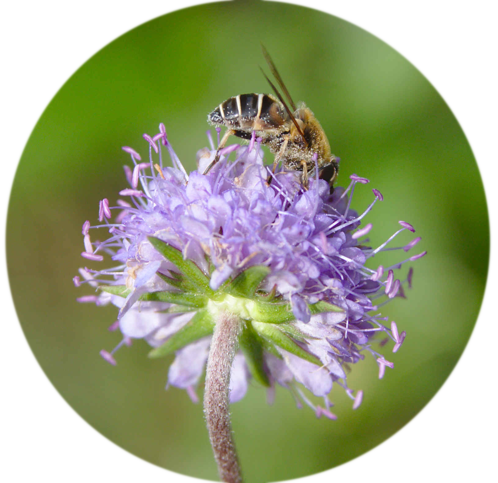{fig-align="center" width="380"}

::: {style="font-size: 18px; text-align: center; color: #555;"}
*Eristalis interruptus* carrying heterospecific pollen loads
:::
:::

::: {.column width="50%"}
{fig-align="center" width="420"}

::: {style="font-size: 18px; text-align: center; color: #555;"}
Stigmatic pollen deposition on *Succisa pratensis*
:::
:::
:::::

::: {style="text-align: center; font-size: 24px; margin-top: 20px; font-weight: bold; color: #1D2D6B;"}
Linking visitation architecture to actual stigmatic pollen deposition, heterospecific clogging, and plant seed set!
:::

## Ecoflor 2027!

{fig-align="center" width="700"}


##  {background-image="images/Fin.jpg"}

<br>

<div style="text-align: center; margin-bottom: 22px;">
<div style="display: inline-block; background-color: rgba(0, 0, 0, .65); backdrop-filter: blur(8px); -webkit-backdrop-filter: blur(8px); box-shadow: 0 4px 20px rgba(0, 0, 0, .5); border-radius: 10px; border: 1px solid rgba(255, 255, 255, 0.18); padding: 18px 38px; color: white; font-size: 38px; font-weight: bold; text-shadow: 0 2px 4px rgba(0,0,0,0.8);">
Thank you for your attention!
</div>
</div>

<div style="background-color: rgba(0, 0, 0, .65); backdrop-filter: blur(8px); -webkit-backdrop-filter: blur(8px); box-shadow: 0 4px 20px rgba(0, 0, 0, .5); border-radius: 10px; border: 1px solid rgba(255, 255, 255, 0.18); padding: 18px 30px; max-width: 630px; margin: 0 auto; text-align: center; color: white; font-family: 'Jost', sans-serif;">

<div style="font-size: 27px; font-weight: bold; color: #FFFFFF; text-shadow: 0 1px 3px rgba(0,0,0,0.9);">Jakub Štenc</div>
<div style="font-size: 20px; color: #E2E8F0; margin-top: 5px; text-shadow: 0 1px 3px rgba(0,0,0,0.9);">jakubstenc@gmail.com &nbsp;|&nbsp; +420 774 553 734</div>
<div style="font-size: 19px; color: #CBD5E1; margin-top: 3px; text-shadow: 0 1px 3px rgba(0,0,0,0.9);">Charles University, Prague &amp; CREAF, Barcelona</div>

<div style="margin-top: 14px; font-size: 20px; color: #FBBF24; font-weight: bold; letter-spacing: 0.3px; text-shadow: 0 1px 3px rgba(0,0,0,0.9);">
🌸 Save the date: Ecoflor 2027 in Prague!
</div>

</div>

{.absolute bottom="0%" right="25%" width="190"} {.absolute bottom="0%" left="0" width="230"} {.absolute bottom="8%" left="0%" width="170"} {.absolute bottom="8%" right="5%" width="170"}

# Appendix & Backup Slides {background-color="#333"}

## Appendix: 15-Year Network Snapshots

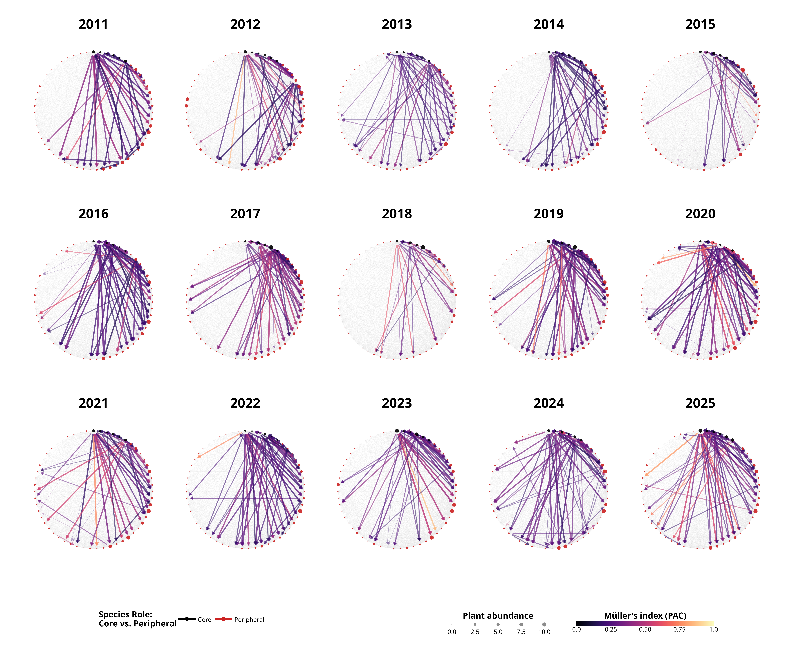{fig-align="center" height="600"}

::: notes
Circular representation of annual networks across all 15 years. Fixed species angles around the perimeter. Black = core, Red = peripheral. Notice dramatic concentration in 2015 and 2018.
:::

## Appendix: Modularity Cartography & Markov Roles

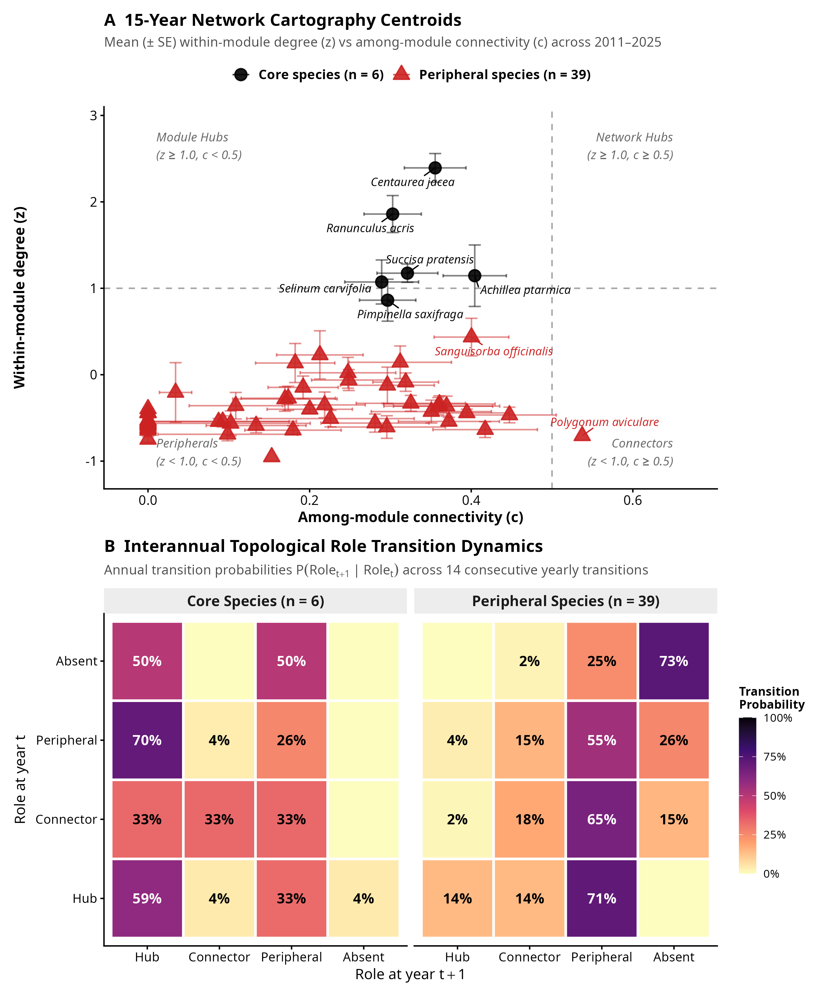{fig-align="center" height="550"}

::: notes
Multi-year Guimerà & Amaral modularity cartography: core species consistently occupy high within-module degree (z = 0.86-2.39).
Longitudinal Markov role transitions demonstrate hub fidelity: core species retain hub status 59.2% of years and have 70.4% rebound probability with <=4% dropout risk, vs 3.5% hub attainment for peripherals.
:::

## Appendix: Abundance vs Degree Correlation

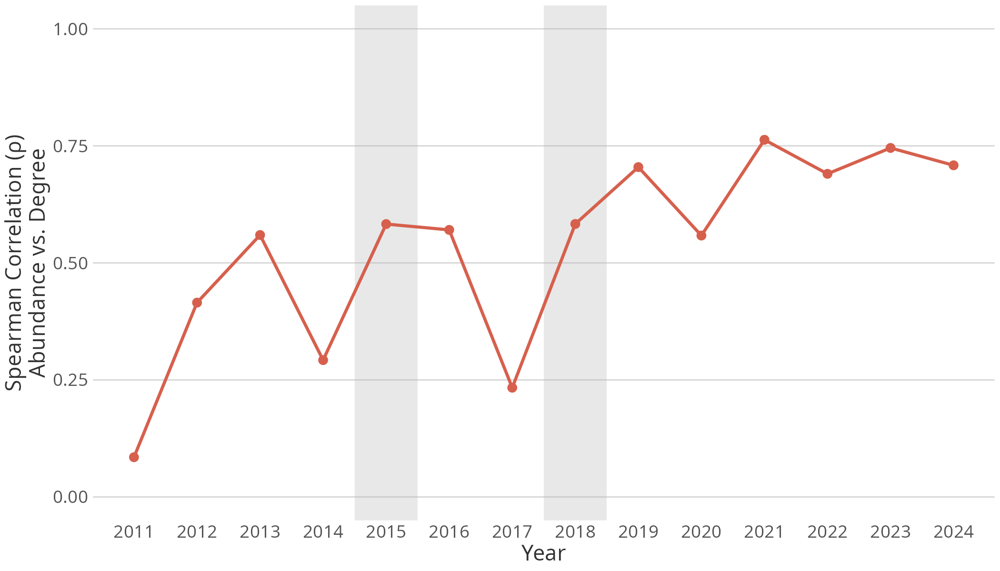{fig-align="center" height="550"}

::: notes
Correlation between floral abundance and species degree fluctuates across years, dropping significantly during droughts (e.g. 2011 and 2018), proving that abundance does not dictate network roles.
:::

## Appendix: Pollinator Concentration & Dietary Restriction

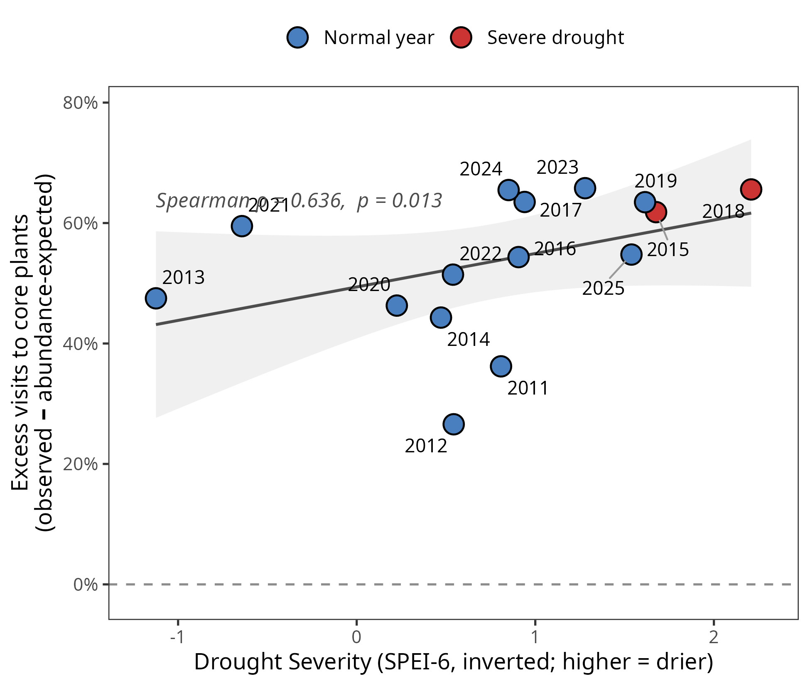{fig-align="center" height="550"}

::: notes
SI Appendix Fig S7: Direct empirical proof of pollinator dietary restriction during droughts. When peripheral plants wither, pollinators dynamically re-allocate foraging to the core, receiving +62% to +66% excess visits beyond abundance expectations.
:::

## Appendix: Turnover Deviation vs Null Models

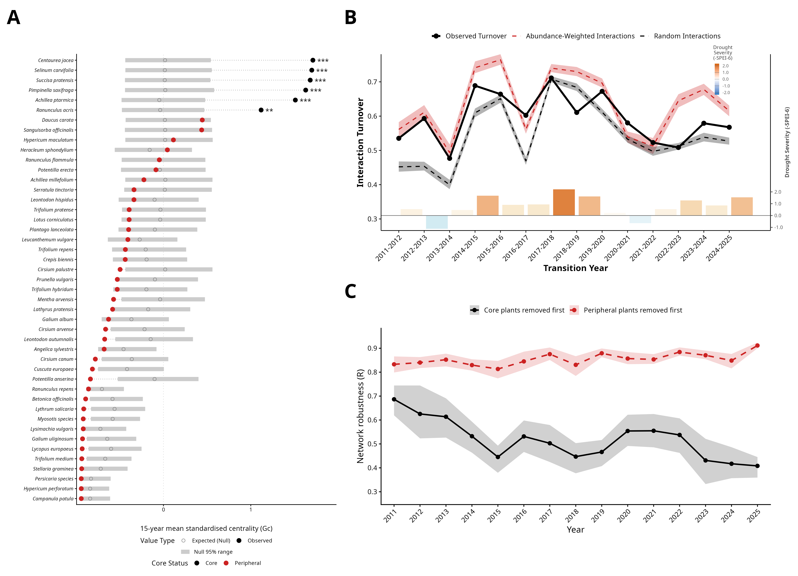{fig-align="center" height="550"}

::: notes
Figure 2 from the manuscript: Panel A core definition, Panel B observed turnover vs abundance-weighted and random rewiring null models with drought bars, and Panel C robustness curves.
:::

## Appendix: Full Mechanistic Cascade (Figure 3)

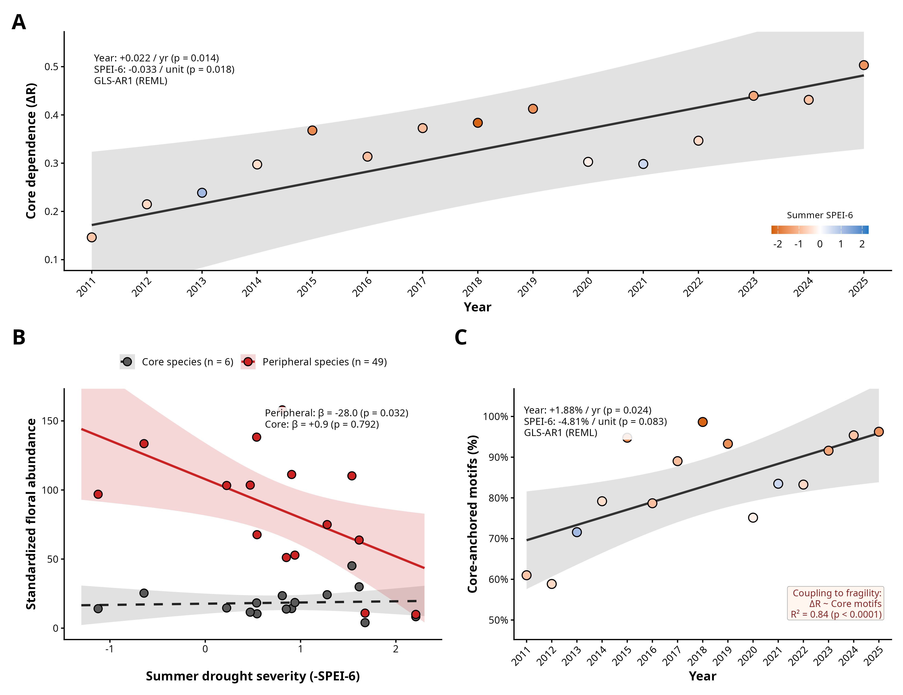{fig-align="center" height="550"}

::: notes
Figure 3 from manuscript: Panel A network vulnerability over time and drought; Panel B floral asymmetry; Panel C motif scaffolding driving network fragility.
:::
