#  {background-image="images/90985051_3160362750661404_9121786830419656704_o.jpg" style="text-align: center;"}

<h2 style="text-align:center;font-size: 32px;color:white; text-align:center;">

::: {style="background-color: rgba(0, 0, 0, .55); backdrop-filter: blur(6px); box-shadow: 0 0 1.5rem 0 rgba(0, 0, 0, .6); border-radius: 8px; padding: 18px;"}
Architecture of stability: 15 years of pollinator sharing reveal a role of stable core species

**Jakub Štenc**^1,2,3^, Sailee P. Sakhalkar^4^, Jiří Hadrava^2^, Michael Mikát^2^, Eva Matoušková^1^, Helena Pijálková^2^, Tadeáš Ryšan^2,5^, Petr Švanda^1,2^, Martin Freudenfeld^1^, Eva Horčičková^6^, Zdeněk Janovský^7^, Jakub Straka^2^, Jordi Bosch^3^

^1^Charles University (Botany) | ^2^Charles University (Zoology) | ^3^CREAF, Spain

:::

</h2>

{.absolute bottom="0%" left="0" width="230"}

{.absolute bottom="8%" left="0%" width="170"} {.absolute bottom="8%" right="0%" width="170"}

##  {background-video="images/video_intro_reduced_shorter.mp4" background-video-loop="true" background-video-muted="true"}

::: notes
Atmospheric introduction to the Handrkov meadow:
Species-rich submontane grassland ecosystem where dozens of entomophilous plants bloom simultaneously, all sharing a finite pool of flower visitors.
:::

## Interactions

::: r-stack
{fig-align="center" width="620"}

{.fragment fig-align="center" width="625"}

{.fragment fig-align="center" width="630"}
:::

::: notes
Start with pollination biology: In species-rich meadows, pollinators are a shared, limiting mutualistic service. 
Co-flowering plants do not interact in isolation; sharing insect visitors mediates indirect interactions—both facilitation (magnet plants) and competition (heterospecific pollen deposition, stigma clogging, pollen dilution).
The paradox: Short-term network studies show massive year-to-year turnover and rewiring. Yet, diverse plant communities persist for decades. 
Is this sharing web in constant chaotic drift, or does an underlying stable architecture anchor the community?
:::

##  {style="margin-top: -15px;"}

::: r-stack
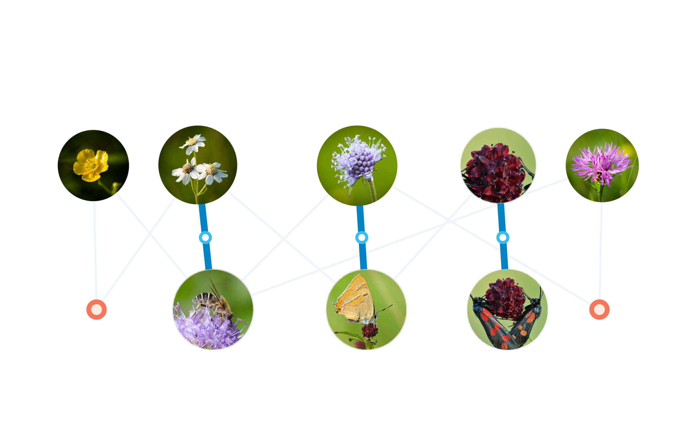{.fragment .fade-out fragment-index=1 height="540px" fig-align="center"}

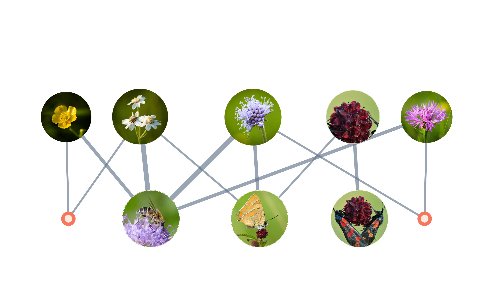{.fragment .fade-in-then-out fragment-index=1 height="540px" fig-align="center"}

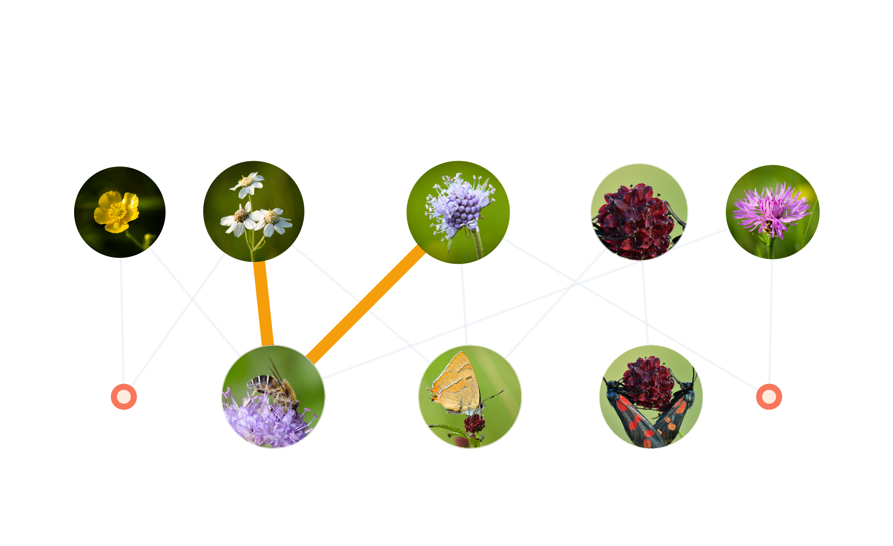{.fragment .fade-in-then-out fragment-index=2 height="540px" fig-align="center"}

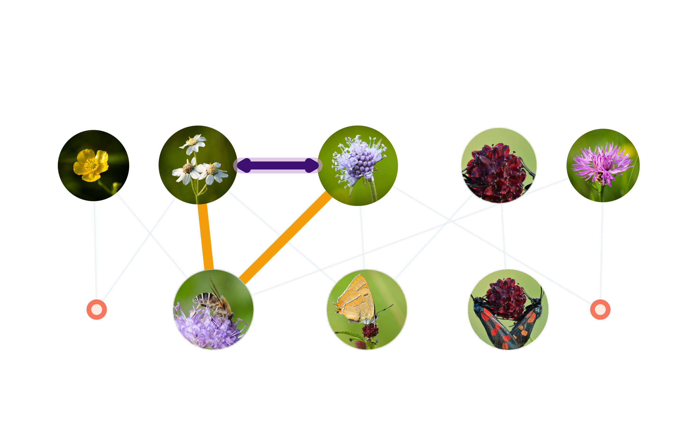{.fragment .fade-in-then-out fragment-index=3 height="540px" fig-align="center"}

{.fragment .fade-in fragment-index=4 height="540px" fig-align="center"}
:::

::: notes
Step 1 (First visit links): We start from empirical flower visits in the field—an insect landing on a flower.
Step 2 (Bipartite Web): As dozens of co-flowering plant species and hundreds of insect visitors interact across the meadow, these individual visits weave together into a bipartite plant-pollinator interaction network.
Step 3 (Shared Pollinator): Plants do not interact directly; they interact through shared flower visitors. Here, Eristalis visits both Achillea and Succisa (yellow lines).
Step 4 (Living Bridge / Indirect Pollen Link): Because the shared pollinator moves between both flowers, an indirect functional link connects the two plant species (blue line).
Step 5 (Pollinator-Sharing Network): By projecting these shared visits across the whole community, we reveal the unipartite pollinator-sharing web—a topological network of plants anchored by dense shared connections!
:::

## Airports and Meadows {style="margin-top: -12px; margin-bottom: 4px;"}

::::: columns
::: {.column width="49.5%"}
::: {.fragment fragment-index=1 style="text-align: center; font-weight: bold; color: #40695B; font-size: 21px; margin-bottom: 4px;"}
✈️ European Aviation Network
:::

::: r-stack
{.fragment .fade-in-then-out fragment-index=1 height="520px" fig-align="center"}

{.fragment .fade-in-then-out fragment-index=2 height="520px" fig-align="center"}

{.fragment .fade-in-then-out fragment-index=3 height="520px" fig-align="center"}

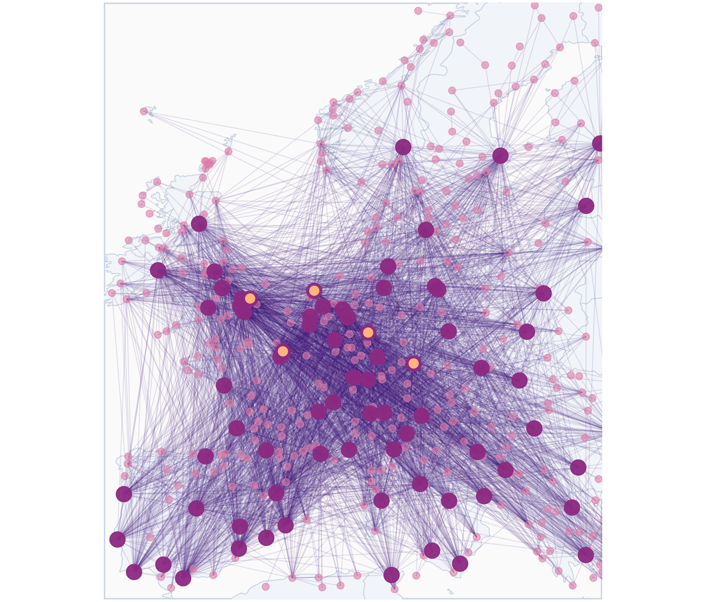{.fragment .fade-in-then-out fragment-index=4 height="520px" fig-align="center"}

{.fragment .fade-in fragment-index=5 height="520px" fig-align="center"}
:::
:::

::: {.column width="49.5%"}
::: {.fragment fragment-index=6 style="text-align: center; font-weight: bold; color: #40695B; font-size: 21px; margin-bottom: 4px;"}
🌸 Meadow Pollinator Sharing
:::

::: r-stack
{.fragment .fade-in-then-out fragment-index=6 height="520px" fig-align="center"}

{.fragment .fade-in-then-out fragment-index=7 height="520px" fig-align="center"}

{.fragment .fade-in fragment-index=8 height="520px" fig-align="center"}
:::
:::
:::::

::: notes
Step 0 (Title only): To understand the stability of our pollination web, let's step outside ecology and look at an analogy from human infrastructure: the European aviation network.
Step 1 (Map): Here is European airspace.
Step 2 (Airports): Across Europe are 895 airports—geographically scattered, seemingly uniform.
Step 3 (Routes): Add 15,000 empirical commercial flight routes—a complex topological web appears.
Step 4 (Yellow Hub Points): Calculate coreness: a tiny core of central hubs pops out with intense connectivity (yellow points).
Step 5 (Airport Names): These are the familiar continental mega-hubs (London, Amsterdam, Frankfurt, Paris, Munich), contrasted with peripheral spokes (Røros, Kristianstad).
Step 6 (Plant Nodes): Now look at our meadow: 55 co-flowering plant species in Handrkov.
Step 7 (Plant Routes): Add empirical pollinator sharing: visitors link plants together through shared service.
Step 8 (Plant Coreness): The exact same architecture emerges! Just 6 core perennial species form the central routing core, while peripheral flora connect through them.
:::

## Defining the Core {style="margin-top: -12px; margin-bottom: 4px;"}

::: {.absolute .fragment .fade-in-then-out fragment-index=1 top="95" left="245" width="560" style="z-index: 10;"}
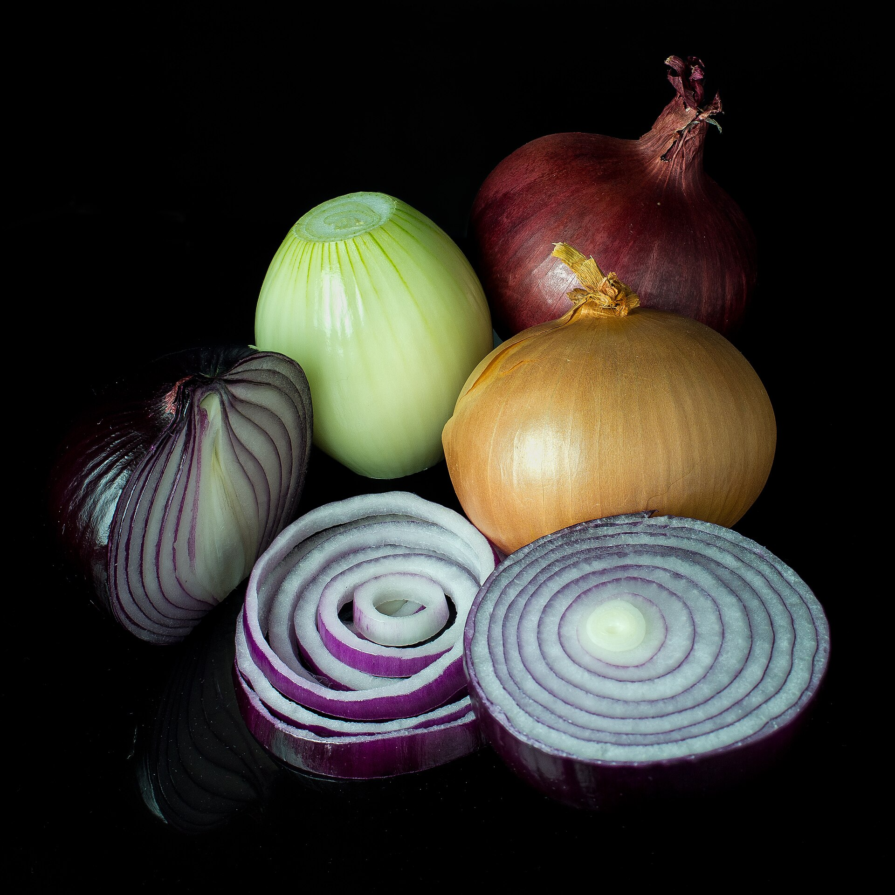

Photo: Colin, Wikimedia Commons, CC BY-SA 3.0

:::

:::::: columns
::: {.column width="33%"}
::: {.fragment fragment-index=2}

● Step 1: Intact Web

All species ($k \ge 1$)

:::
:::

::: {.column width="33%"}
::: {.fragment fragment-index=3}

● Step 2: Iterative Peeling

Pruning periphery ($k \ge 2$)

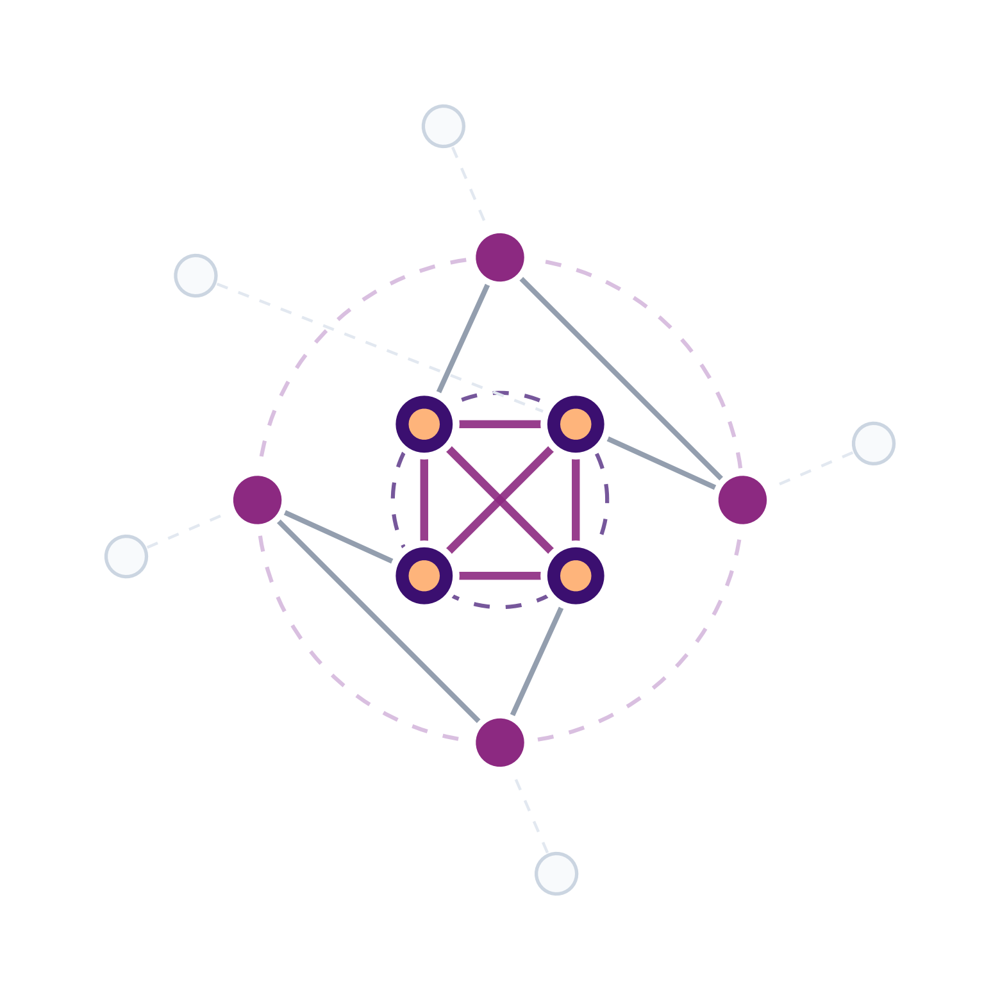

:::
:::

::: {.column width="33%"}
::: {.fragment fragment-index=4}

● Step 3: Invariant Core

Mutually linked backbone ($k = k_{\max}$)

:::
:::
::::::

::: {.fragment fragment-index=5}

Centaurea (core)

Daucus (periphery)

201120122013201420152016201720182019202020212022202320242025

● central that year 15 / 15 vs 5 / 15 years

:::

::: notes
Slide: What actually makes a species part of the core? Network topology defines this using k-core decomposition (Seidman 1983).
[Click 1 – onion]: How do we decide which species form the core? Think of the network as an onion: we peel it layer by layer, and what is left at the centre is the core.
Think of it like peeling an onion:
- Step 1 (The Entire Web): We start with all species connected (k >= 1). Outer peripheral species (coral/red) connect by only a single link.
- Step 2 (Iterative Peeling): We peel away outer shells: any species whose degree drops below k is successively pruned. Single-link leaves fall away first.
- Step 3 (The Invariant Core): At k_max, only the mutually reinforcing central backbone remains (navy hubs with gold centers). These core hubs don't just have visits—they link to each other, creating the structural foundation that holds the entire community together.
- Step 5 (Every year): We repeat this for each of the 15 annual networks. Filled dot = species is central that year (standardized coreness Gc > 1). Centaurea jacea (core) is central in all 15 years; Daucus carota (the next-ranked, peripheral species, present all 15 years) only in 5 (2012–14, 2022–23). Centrality ranks are strongly preserved between years (Kendall's W = 0.64 vs 0.23 expected by chance, p = 0.001; consecutive years Spearman median 0.77). Centaurea jacea sits above the null in all 15 years.
:::

## Robustness {style="margin-top: -12px; margin-bottom: 4px;"}

::: {.absolute .fragment .fade-in-then-out fragment-index=1 top="150" left="345" width="360" style="z-index: 10;"}

:::

::::: columns
::: {.column width="50%"}
::: r-stack
{height="490px" fig-align="center"}

{.fragment .fade-in-then-out fragment-index=2 height="490px" fig-align="center"}

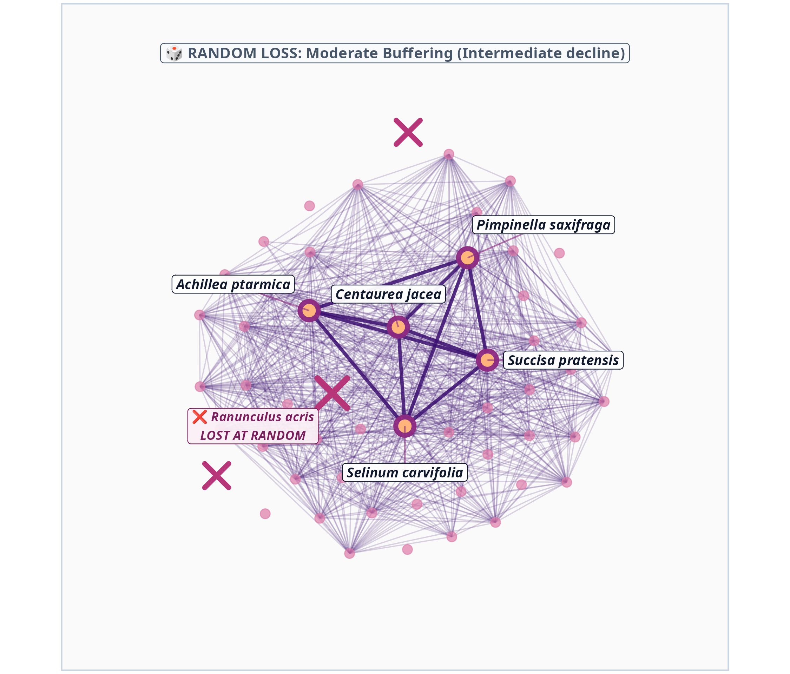{.fragment .fade-in-then-out fragment-index=3 height="490px" fig-align="center"}

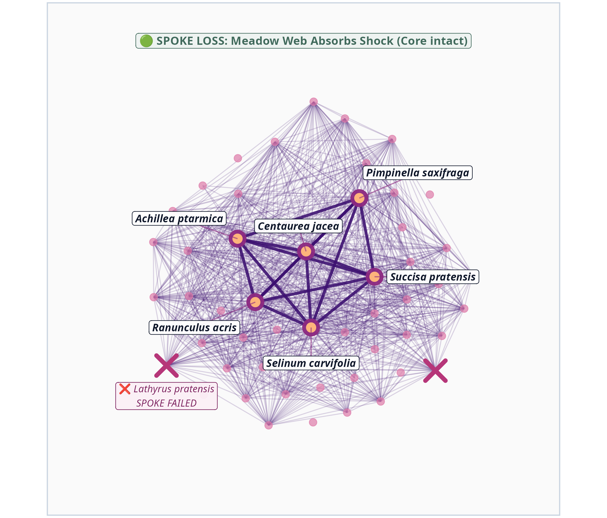{.fragment .fade-in-then-out fragment-index=4 height="490px" fig-align="center"}

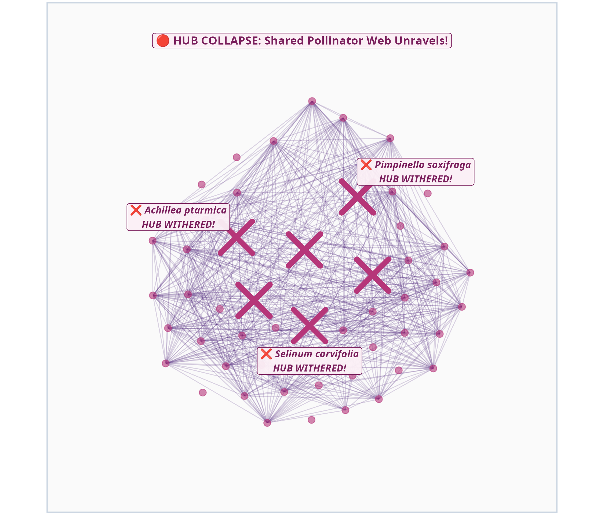{.fragment .fade-in fragment-index=5 height="490px" fig-align="center"}
:::

::: {.fragment fragment-index=2 style="font-size: 14px; text-align: center; color: #64748B; margin-top: 4px;"}
*Meadow pollinator sharing network under simulated extinction scenarios*
:::
:::

::: {.column width="48%"}
::: r-stack
{height="490px" fig-align="center"}

{.fragment .fade-in-then-out fragment-index=2 height="490px" fig-align="center"}

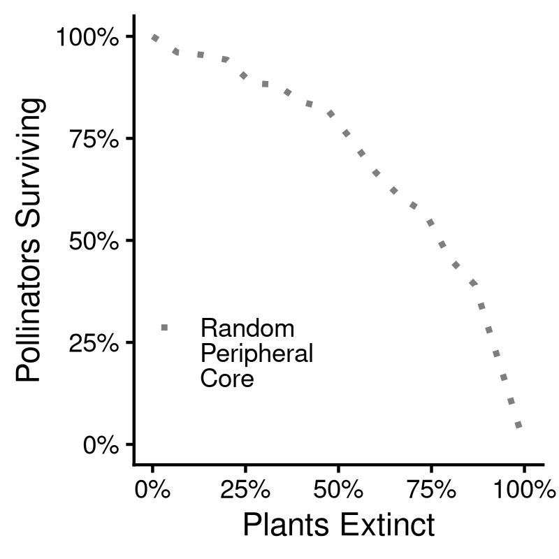{.fragment .fade-in-then-out fragment-index=3 height="490px" fig-align="center"}

{.fragment .fade-in-then-out fragment-index=4 height="490px" fig-align="center"}

{.fragment .fade-in fragment-index=5 height="490px" fig-align="center"}
:::

::: {.fragment fragment-index=2 style="font-size: 14px; text-align: center; color: #64748B; margin-top: 4px;"}
*Co-extinction simulation (Memmott et al. 2004) on Handrkov pollination web*
:::
:::
:::::

::: notes
Slide 6: Here is how network theory formalizes robustness (Memmott et al. 2004).
Step 0: Title only.
Step 0b (broken network icon): What happens to the network when species disappear?
Step 1 (Axes & Intact Web): Here are the co-extinction axes: proportion of plants extinct vs pollinators surviving, alongside our intact Handrkov sharing network.
Step 2 (Random Loss): When species disappear at random, robustness shows a steady, intermediate decline.
Step 3 (Peripheral Spoke Loss): When peripheral species are removed first (red dashed line), the curve stays flat near 100%! Almost all pollinators survive because the central core anchors them. High robustness (R ≈ 0.85).
Step 4 (Core Hub Collapse): BUT when core hubs collapse (solid navy line), the curve plummets immediately! Losing Centaurea and Succisa causes massive secondary cascades. Low robustness (R ≈ 0.45).
Bridge (spoken, no extra click): But this is one snapshot. How does this picture change across 15 years of increasingly dry summers?
:::

## Drought {style="margin-top: -12px; margin-bottom: 4px;"}

{.nostretch width="100%" height="450px" style="object-fit: contain; margin-top: 10px;"}

::: {style="font-size: 18px; text-align: center; color: #888888; margin-top: 5px;"}
*Data: TerraClimate (Abatzoglou et al., 2018), Handrkov locality (1975–2025)*
:::

::: notes
In theory, networks collapse when the core is removed. But in reality, networks change in time as they are under pressure from the environment—specifically drought. Looking across the last 50 years at our meadow, drought has become an increasingly severe and persistent pressure.
:::

## Drought {style="margin-top: -12px; margin-bottom: 4px;"}

{.nostretch width="100%" height="450px" style="object-fit: contain; margin-top: 10px;"}

::: {style="font-size: 18px; text-align: center; color: #888888; margin-top: 5px;"}
*Data: TerraClimate (Abatzoglou et al., 2018), Handrkov locality (1975–2025)*
:::

::: notes
And especially in the last 15 years—the exact window of our field survey—drought seems to be a reoccurring pressure on the system.
:::

## Drought {style="margin-top: -12px; margin-bottom: 4px;"}

{.nostretch width="100%" height="450px" style="object-fit: contain; margin-top: 10px;"}

::: {style="font-size: 18px; text-align: center; color: #888888; margin-top: 5px;"}
*Data: TerraClimate (Abatzoglou et al., 2018), Handrkov locality (2011–2025)*
:::

:::: {.fragment .absolute top="26%" left="14%" width="72%"}
<h2 style="text-align:center;color:white; margin: 0;">

::: {style="background-color: rgba(0, 0, 0, 0.85); backdrop-filter: blur(8px); box-shadow: 0 16px 40px rgba(0, 0, 0, 0.6); border-radius: 12px; padding: 24px 30px; border: 1px solid rgba(255, 255, 255, 0.22); text-align:center; font-size: 34px; font-weight: 700; line-height: 1.35;"}
How does reoccurring drought affect network robustness?
:::

</h2>
::::

::: notes
Zooming into our 15-year period: only 2013 and 2021 were wet summers. 2018 was the driest, followed by 2015, 2019 and 2025, and 2023 was also dry. Drought is not a single event here but a recurring condition. So our key question is: How does this reoccurring drought affect network robustness?
:::

## Methods - the locality

::::: {style="display: flex; justify-content: center; align-items: flex-end; gap: 50px; margin-top: 30px;"}
::: {.fragment style="text-align: center; flex: 1;"}

Czech Republic

:::

::: {.fragment style="text-align: center; flex: 1.3;"}

Rich in flowers

:::
:::::

::: {.fragment style="text-align: center; font-size: 34px; font-weight: 600; margin-top: 40px;"}
15 years of data collection (2011–2025)
:::

## Methods - permanent plots

::::: {style="display: flex; justify-content: center; align-items: flex-start; gap: 28px; margin-top: 30px;"}
::: {.fragment style="text-align: center; flex: 1;"}

plots are marked

:::

::: {.fragment style="text-align: center; flex: 1;"}

recovered every year

:::

::: {.fragment style="text-align: center; flex: 1.25;"}
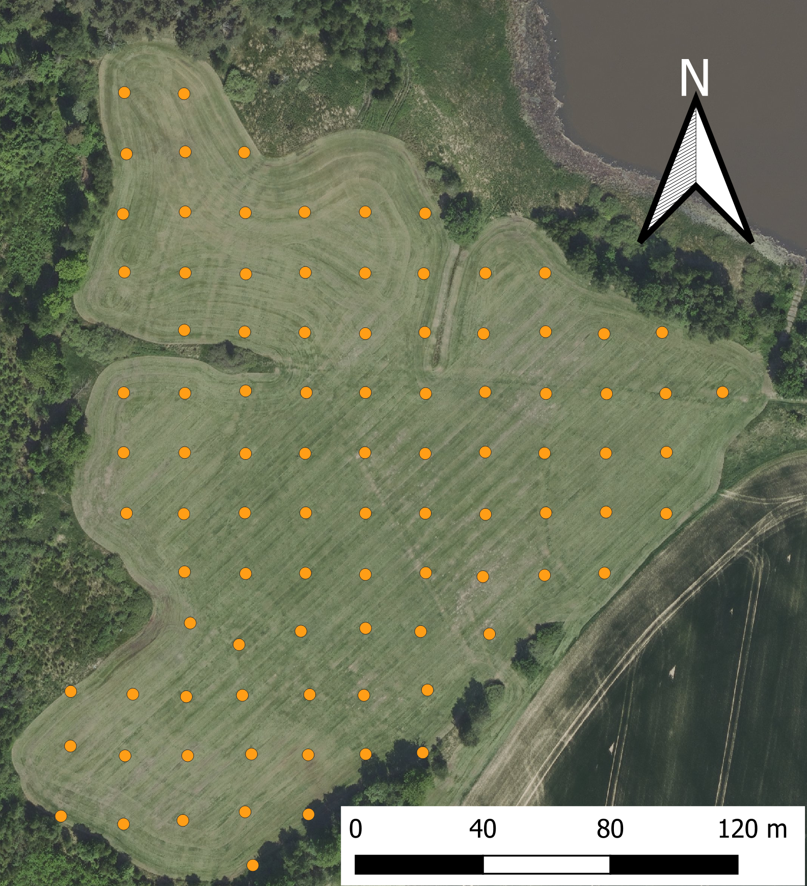

93 plots in total

:::
:::::

## Methods - plant-pollinator survey

::::: {layout="[0.5, 0.5]"}
::: {.fragment top="70" height="400"}
![[Plant survey]{style="font-size: 32px;"}](images/Picture1.jpg)
:::

::: {.fragment top="70" height="400"}
![[Pollinator survey]{style="font-size: 32px;"}](images/Picture5.jpg)
:::
:::::

## Methods - plant survey

:::: {layout="[0.5, 0.5]"}
::: {.fragment top="70" height="400"}

:::

<!-- empty column to create gap -->
::::

::: {.absolute .fragment top="10%" left="55%"}
-   4 x 4 meter squares
-   Stalks of flowering plants are counted or scored presence/absence in subplots
-   2 times per sampling period
:::

## Methods - pollinator survey

::::: {layout="[0.5, 0.5]"}
::: {.fragment top="70" height="400"}

:::

<!-- empty column to create gap -->

:::::

::: {.absolute .fragment top="10%" left="55%"}
-   "Snapshot" of plant-pollinator interaction
-   20–63 surveys per plot per year (median 28)
-   42 378 surveys in total
-   68 460 interactions recorded
-   176 pollinator taxa × 55 plant species
:::

## Methods - plant-pollinator survey

## Methods - plant-pollinator survey

## Methods - plant-pollinator survey

## Methods - plant-pollinator survey

## Networks

{fig-align="center" height="600"}

## Year-to-Year Change

::: r-stack
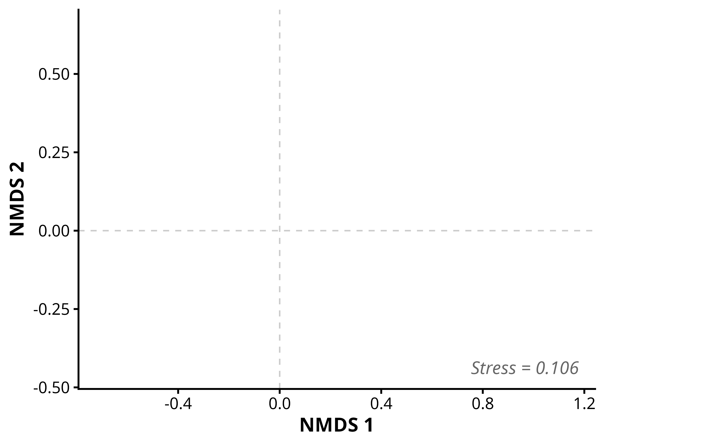{.fragment .fade-out fragment-index=1 fig-align="center" height="550px"}

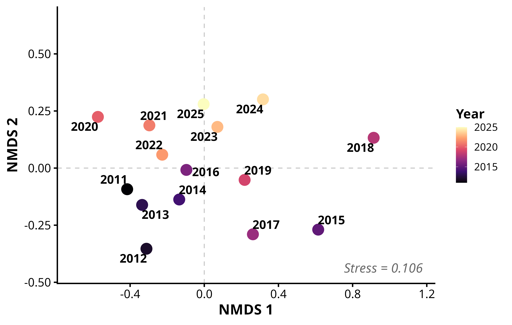{.fragment .fade-in-then-out fragment-index=1 fig-align="center" height="550px"}

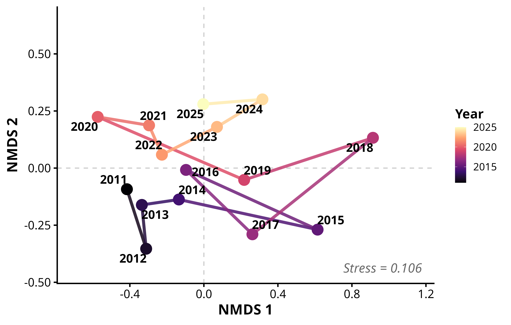{.fragment .fade-in-then-out fragment-index=2 fig-align="center" height="550px"}

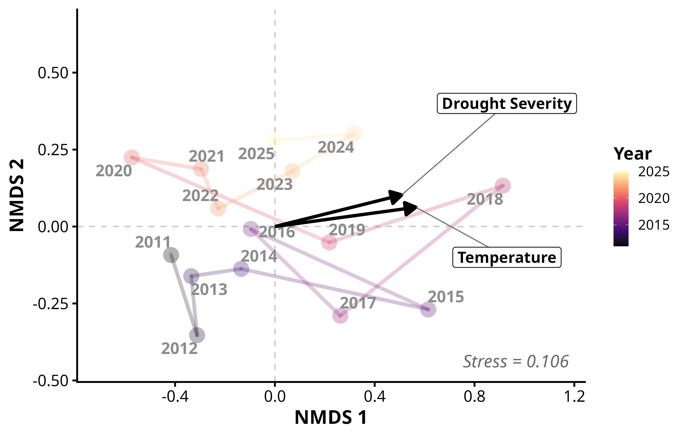{.fragment .fade-in-then-out fragment-index=3 fig-align="center" height="550px"}

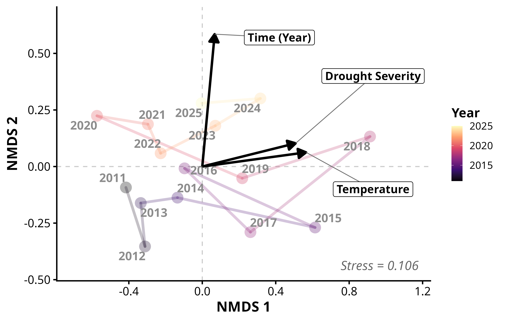{.fragment .fade-in-then-out fragment-index=4 fig-align="center" height="550px"}

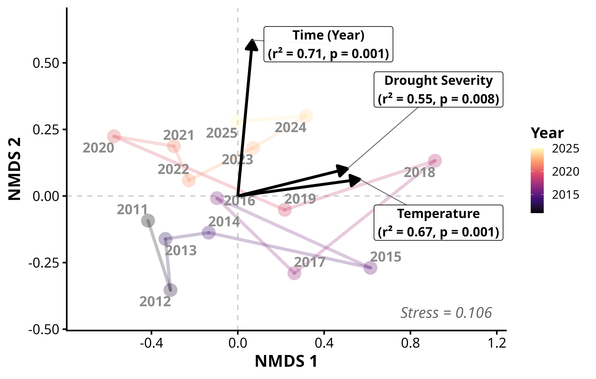{.fragment .fade-in fragment-index=5 fig-align="center" height="550px"}
:::

::: {.fragment .absolute fragment-index=6 top="30%" left="15%" width="70%" style="background-color: rgba(0, 0, 0, 0.85); backdrop-filter: blur(8px); box-shadow: 0 16px 40px rgba(0, 0, 0, 0.6); border-radius: 12px; padding: 20px 30px; border: 1px solid rgba(255, 255, 255, 0.22); color: white; text-align: center; font-size: 28px; font-weight: 700; line-height: 1.35;"}
The network shifts with drought and drifts over time. Do the central species shift too?
:::

::: notes
Non-metric multidimensional scaling (NMDS) of annual directed PAC matrices (Bray-Curtis, stress = 0.106). Each point is one year's pollinator-sharing network.
Fitted vectors (climate arrows appear first, then time):
1. Drier and hotter summers push the network to the right: drought severity (r² = 0.55, p = 0.008), summer temperature (r² = 0.67, p = 0.001). 2018, 2015 and 2019 are furthest right.
2. Time pulls the network steadily upwards (r² = 0.71, p = 0.001), a directional change across 15 years.
After the wetter years (2020–2022) the network moved back left, but did not return to its starting position near 2011–2014.
[Advance]: So the sharing web is far from static. The next question is whether its central species are just as changeable.
:::

## The Core

{fig-align="center" height="540"}

::: {.absolute top="40" left="0" width="150" style="text-align: center; font-size: 14px; font-style: italic; color: #3B0F70; line-height: 1.15;"}
Centaurea jacea
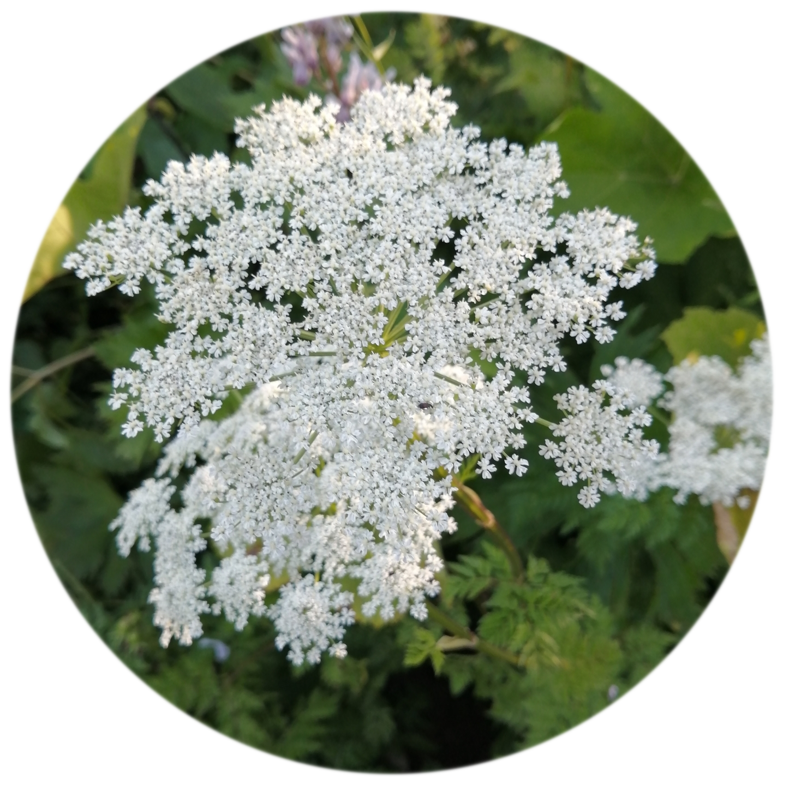Selinum carvifolia
Succisa pratensis
:::

::: {.absolute top="40" right="0" width="150" style="text-align: center; font-size: 14px; font-style: italic; color: #3B0F70; line-height: 1.15;"}
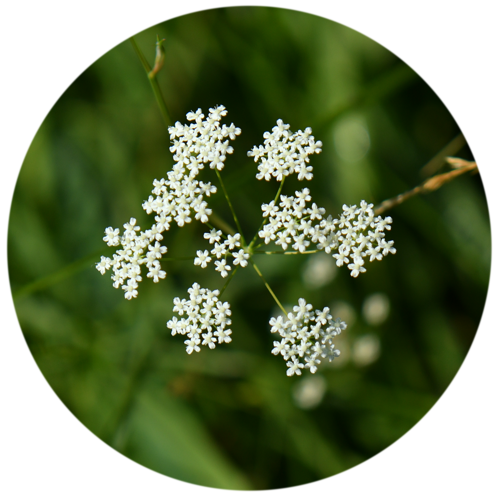Pimpinella saxifraga
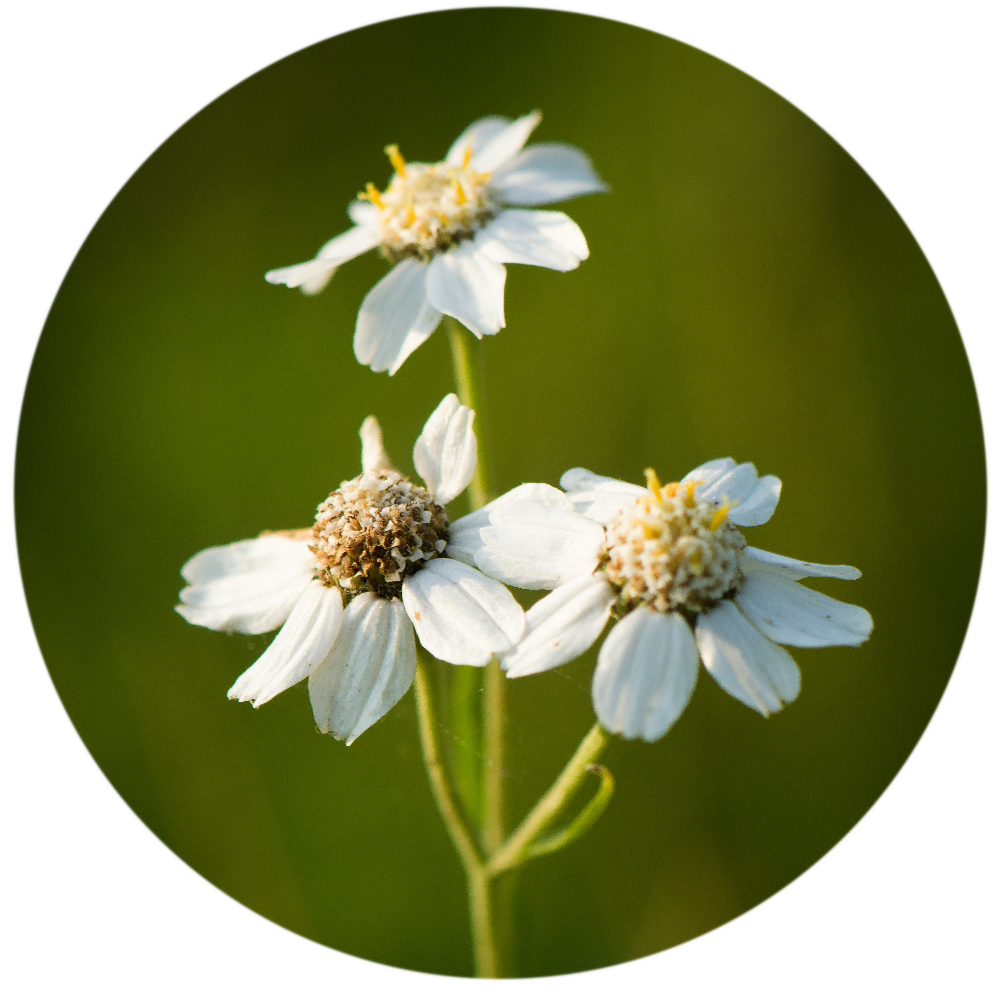Achillea ptarmica
Ranunculus acris
:::

:::: {.fragment .absolute top="25%" left="16%" width="68%"}
::: {style="background-color: rgba(0, 0, 0, 0.85); backdrop-filter: blur(8px); box-shadow: 0 16px 40px rgba(0, 0, 0, 0.6); border-radius: 12px; padding: 26px 36px; border: 1px solid rgba(255, 255, 255, 0.22); color: white; text-align: center;"}

Centrality Variance Explained (Linear Mixed Model)

44%

Floral Abundance

38%

Plant Identity ($p = 1.8 \times 10^{-73}$)

:::
::::

::: notes
Bridge (from the NMDS question): Is Frankfurt a hub because it had an extra runway open on a sunny Tuesday, or because of permanent structural routing? Are network hubs just random flowers that happen to bloom heavily?
We tested each species' 15-year standardized coreness against a conservative, presence-conditional null model (1,000 perms/yr).
Exactly 6 species maintained statistically significant excess centrality (p_adj <= 0.0015).
[Advance to overlay]:
A linear mixed model confirms that while floral abundance explains 44% of centrality variance, plant identity independently explains 38% (p = 1.8e-73).
Side photos: the 6 core species, in the same order as the chart (left: top three, right: next three).
:::

## Robustness over Time

::: r-stack
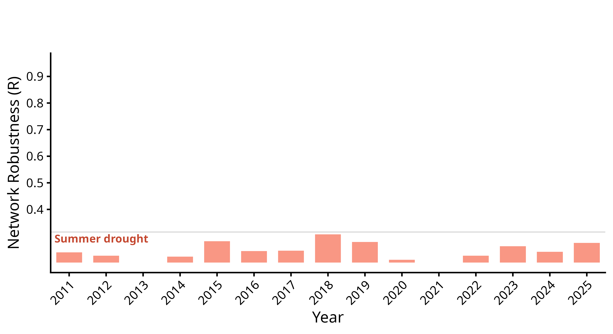{.fragment .fade-out fragment-index=1 fig-align="center" height="550px"}

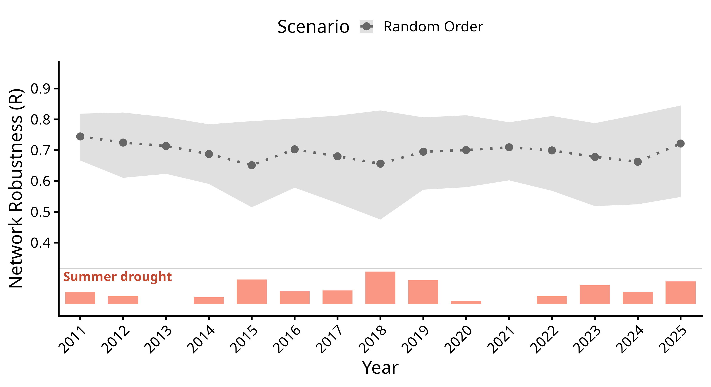{.fragment .fade-in-then-out fragment-index=1 fig-align="center" height="550px"}

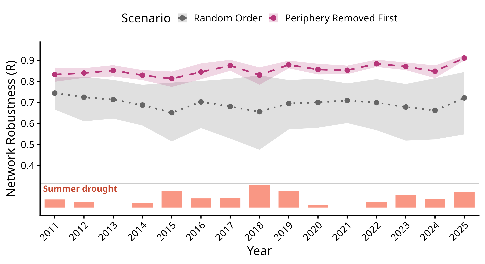{.fragment .fade-in-then-out fragment-index=2 fig-align="center" height="550px"}

{.fragment .fade-in fragment-index=3 fig-align="center" height="550px"}
:::

::: {.fragment .absolute fragment-index=4 top="27%" left="17%" width="66%" style="background-color: rgba(0, 0, 0, 0.85); backdrop-filter: blur(8px); box-shadow: 0 16px 40px rgba(0, 0, 0, 0.6); border-radius: 12px; padding: 20px 30px; border: 1px solid rgba(255, 255, 255, 0.22); color: white; text-align: center; font-size: 28px; font-weight: 700; line-height: 1.35;"}
Same 6 core species, but losing them costs more in dry years and more every year
:::

::: notes
We simulated secondary extinction cascades (Memmott et al. 2004). Robustness R is the area under the co-extinction curve. Orange bars at the bottom = summer drought severity.
Periphery removed first: robustness stays high every year (R = 0.81–0.91).
Random order: intermediate (R = 0.65–0.75).
Core removed first: always the most fragile, and getting worse. R = 0.69 in 2011, dips in the dry years 2015 and 2018 (≈ 0.45), recovers in 2020–2022 (≈ 0.55), and reaches its lowest values in 2023–2025 (0.41–0.43).
So the dependence on the core is driven by drought AND by a long-term trend: core-removal R declines with drier summers (p = 0.005) and with year (p = 0.001). The gap ΔR = R_periph − R_core grows from 0.15 (2011) to 0.50 (2025).
[Advance – circularity overlay; ΔR +0.022/yr, p = 0.014]: Someone may say: of course removing hubs hurts more. But the core identity is fixed for all 15 years. A fixed definition cannot by itself produce a gap that changes with weather and grows over time.
:::

## Why?

::: r-stack
{.fragment .fade-out fragment-index=1 fig-align="center" height="550px"}

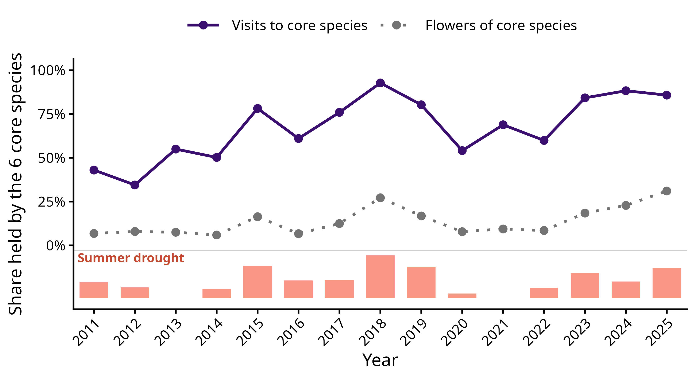{.fragment .fade-in fragment-index=1 fig-align="center" height="550px"}
:::

::: {.fragment .absolute fragment-index=2 top="27%" left="17%" width="66%" style="background-color: rgba(0, 0, 0, 0.85); backdrop-filter: blur(8px); box-shadow: 0 16px 40px rgba(0, 0, 0, 0.6); border-radius: 12px; padding: 20px 30px; border: 1px solid rgba(255, 255, 255, 0.22); color: white; text-align: center; font-size: 28px; font-weight: 700; line-height: 1.35;"}
The core holds 14% of flowers but gets 67% of visits
:::

::: notes
Slide: Why does losing the core cost more and more?
Step 1 (navy): share of all pollinator visits that go to the 6 core species. It rises from 34–55% (2011–14) to 84–88% (2023–25), +2.3 percentage points per year (GLS-AR1, p = 0.001), and is higher in drier summers (p = 0.004). Peaks in 2015 and 2018.
Step 2 (grey): share of flowers produced by the core species. Always far below the visit line: on average 14% of flowers vs 67% of visits over 15 years.
[Advance – overlay]: Pollinators use the core far beyond its flower supply. The more visits concentrate on the core, the more damage its loss does: that is why the robustness gap grows.
Caveat if asked: core flowering also increased in recent years (up to 31% in 2025), so part of the rise in visits follows more core flowers. In dry years peripheral flowering drops (~3× along the drought gradient, p = 0.032; backup slide) while core flowering does not.
:::

## Take-Home Messages

:::::: columns
::: {.column width="33%"}
::: {style="background: #FFFFFF; border: 1px solid #E2E8F0; border-top: 6px solid #3B0F70; border-radius: 10px; padding: 10px 8px 12px 8px; box-shadow: 0 4px 12px rgba(0,0,0,0.05); box-sizing: border-box; text-align: center;"}
<h3 style="font-size: 25px; color: #3B0F70; margin: 2px 0 6px 0; line-height: 1.15;">01 Persistent Core</h3>
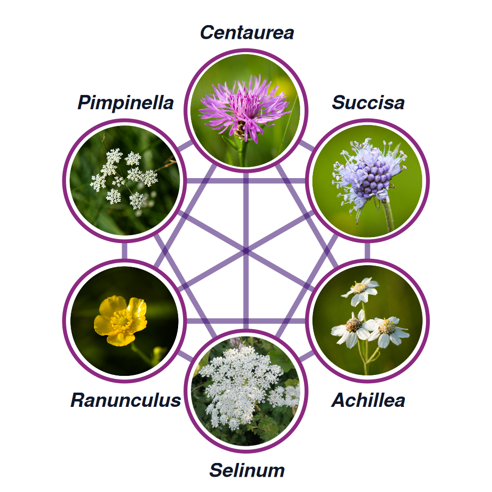

6 species stay central for 15 years

:::
:::

::: {.column width="33%"}
::: {.fragment}
::: {style="background: #FFFFFF; border: 1px solid #E2E8F0; border-top: 6px solid #F8765C; border-radius: 10px; padding: 10px 8px 12px 8px; box-shadow: 0 4px 12px rgba(0,0,0,0.05); box-sizing: border-box; text-align: center;"}
<h3 style="font-size: 25px; color: #F8765C; margin: 2px 0 6px 0; line-height: 1.15;">02 Rising Dependence</h3>
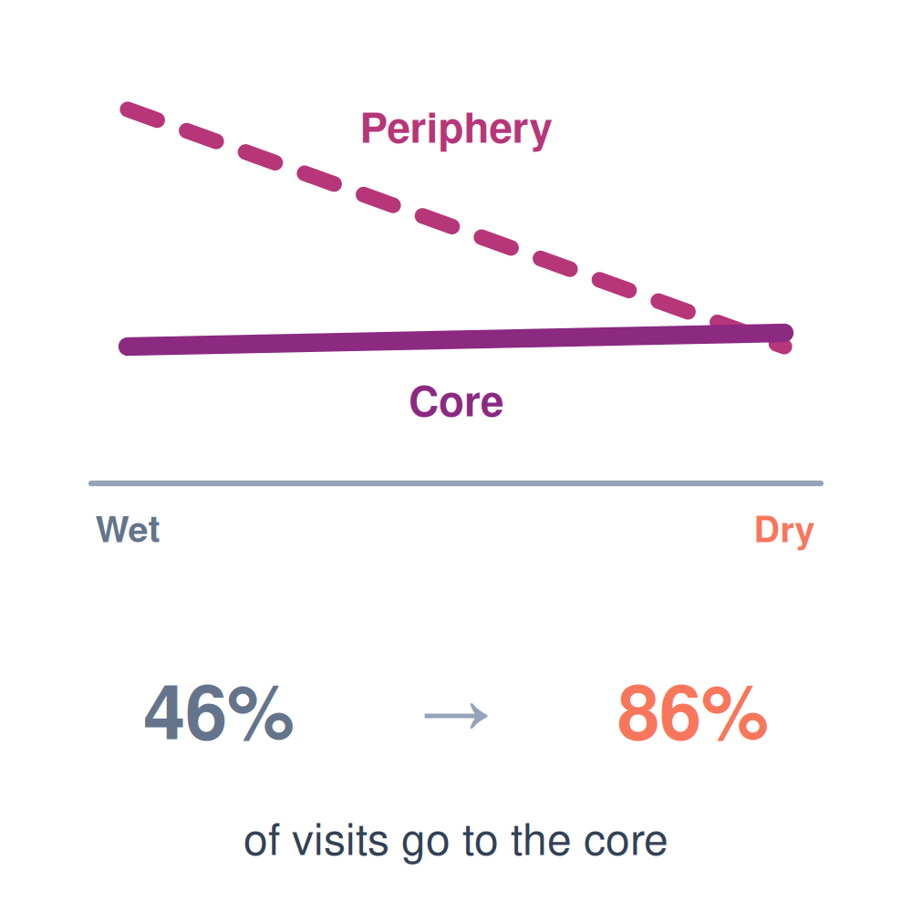

Drought shifts pollinators onto the core

:::
:::
:::

::: {.column width="33%"}
::: {.fragment}
::: {style="background: #FFFFFF; border: 1px solid #E2E8F0; border-top: 6px solid #40695B; border-radius: 10px; padding: 10px 8px 12px 8px; box-shadow: 0 4px 12px rgba(0,0,0,0.05); box-sizing: border-box; text-align: center;"}
<h3 style="font-size: 25px; color: #40695B; margin: 2px 0 6px 0; line-height: 1.15;">03 Protect the Core</h3>
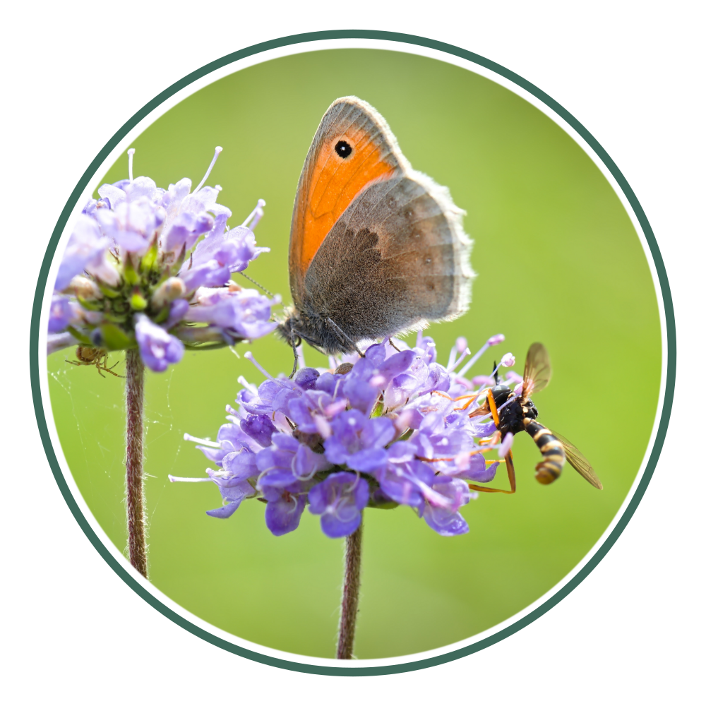

Should we protect species that stay central and keep flowering through perturbations?

:::
:::
:::
::::::

::: notes
1. Architecture: The 15-year dataset reveals that network coreness is topologically invariant and identity-based (LMM p = 1.8e-73, explaining 38% of centrality variance after controlling for flower abundance).
2. Rising Core Dependence (figure: 46% → 86% = mean core share of visits 2011–14 vs 2023–25): Peripheral flowering declines ~3-fold along the drought gradient (p = 0.032), core flowering does not (p = 0.79). The share of visits going to the core rose from 34–55% to 84–88%, and the robustness gap between losing the core and losing the periphery grew from 0.15 to 0.50 over 15 years.
3. Conservation: Grassland management should look beyond simple species counts and protect the species that combine a persistent hub role with drought-stable flowering (e.g. Centaurea, Succisa, Selinum).
:::

## Future Steps?

::: fragment
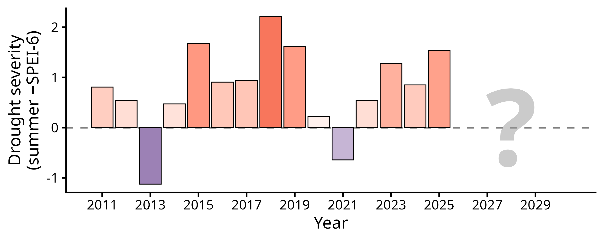{.nostretch width="100%" height="480px" style="object-fit: contain; margin-top: 10px;"}

::: {style="font-size: 18px; text-align: center; color: #888888; margin-top: 5px;"}
*Data: TerraClimate (Abatzoglou et al., 2018), Handrkov locality (2011–2025)*
:::
:::

::: notes
Drought keeps coming back, and the network leans more and more on the core. What happens in the next dry summers? Will the core keep holding, or will it fail too?
:::

## Next Step: Pollen Transfer

::: {.fragment fragment-index=1}
::::: {style="display: flex; justify-content: center; align-items: flex-start; gap: 60px; margin-top: 25px;"}
::: {style="text-align: center; flex: 1; max-width: 450px;"}
{height="480px" style="object-fit: contain; display: block; margin: 0 auto;"}
:::

::: {style="text-align: center; flex: 1; max-width: 450px;"}
{height="480px" style="object-fit: contain; display: block; margin: 0 auto;"}
:::
:::::
:::

::: {.absolute .fragment fragment-index=2 top="14%" left="11%" width="78%" style="background: white; border-radius: 12px; box-shadow: 0 16px 40px rgba(0, 0, 0, 0.35);"}
::: r-stack
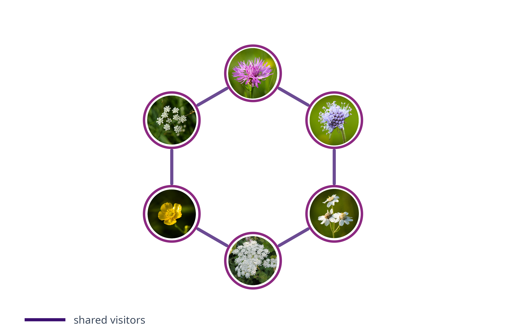{.fragment .fade-out fragment-index=3 width="100%"}

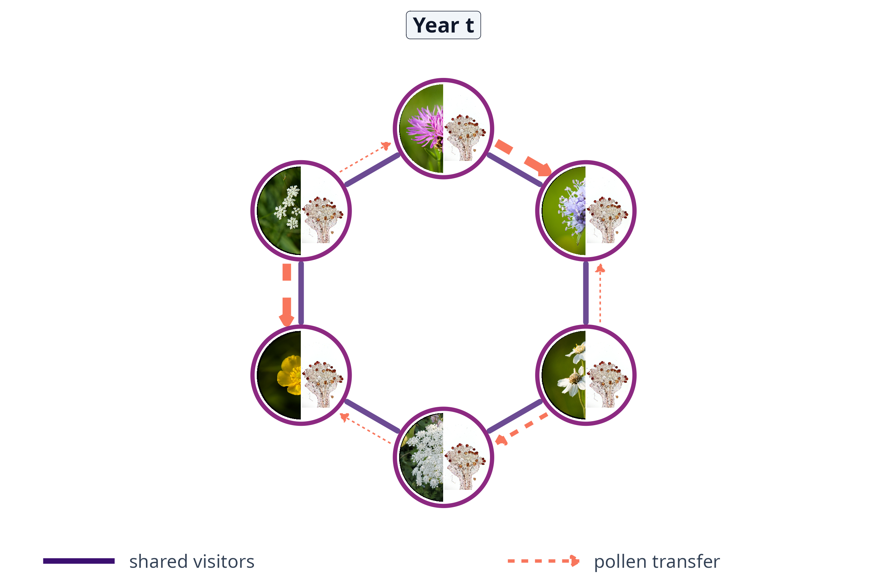{.fragment .fade-in-then-out fragment-index=3 width="100%"}

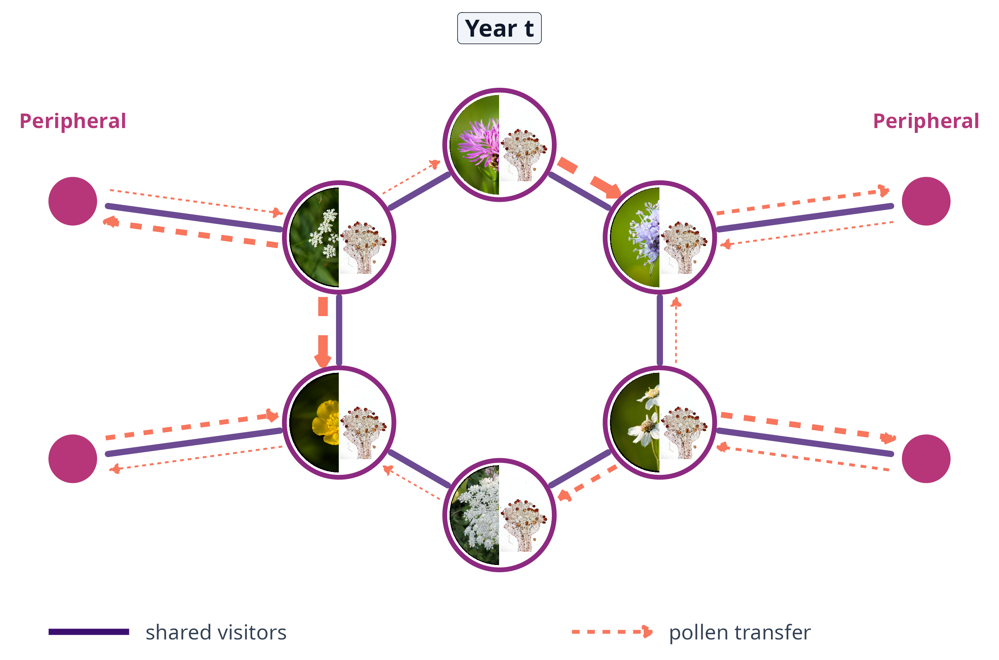{.fragment .fade-in-then-out fragment-index=4 width="100%"}

{.fragment .fade-in fragment-index=5 width="100%"}
:::
:::

::: notes
Slide: Next Step — Real Pollen Deposition Dynamics.
Linking visitation architecture to actual stigmatic pollen deposition, heterospecific clogging, and plant seed set!
Left photo: Eristalis interruptus carrying heterospecific pollen loads. Right: stigmatic pollen deposition on Succisa pratensis.
Overlay (concept, not data): 1) core species linked by shared visitors; 2) dashed arrows = pollen actually transferred, which can differ in direction and strength from visitation; 3) between core and periphery pollen flows both ways, unequally; 4) the next year, visitation looks the same but pollen transfer within the core can change.
We tracked individual pollinators carrying heterospecific pollen loads (e.g. Eristalis interruptus) and quantified how this translates to actual stigmatic pollen deposition and ovule fertilization on Succisa pratensis.
:::

## Handrkov

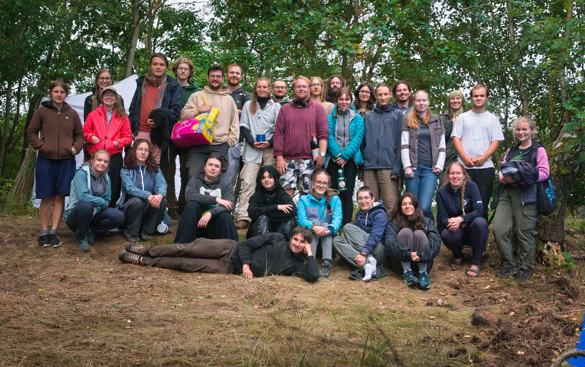{fig-align="center" height="520"}

## Handrkov - Collaboration

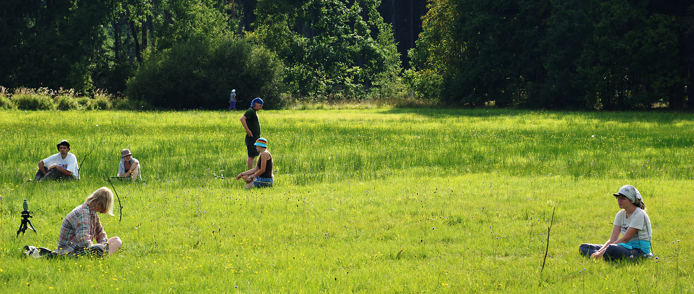{fig-align="center" width="950"}

## Handrkov - Collaboration

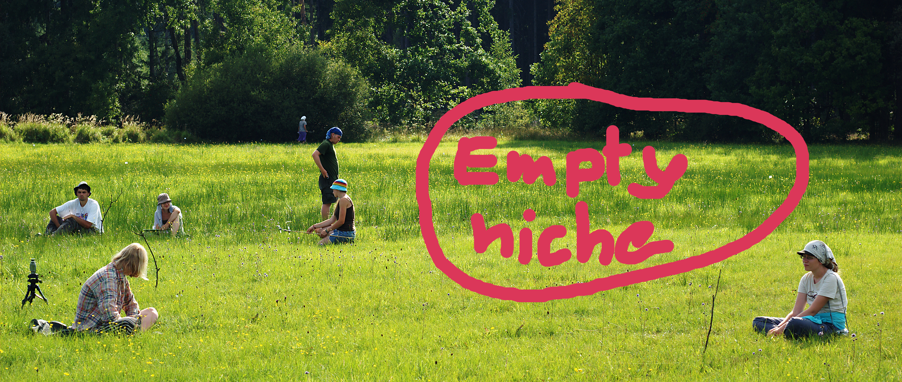{fig-align="center" width="950"}

  <a href="https://pollination-ecology-group.github.io/Handrkov/" target="_blank" style="color: #40695B; font-weight: 600; text-decoration: underline;">https://pollination-ecology-group.github.io/Handrkov/</a>
  |
  <a href="mailto:jakubstenc@gmail.com" style="color: #374151; text-decoration: none;">jakubstenc@gmail.com</a>

## Handrkov - Collaboration

{fig-align="center" width="950"}

:::: {.absolute top="34%" left="32%" width="36%"}
<h2 style="text-align:center;color:white; margin: 0;">

::: {style="background-color: rgba(0, 0, 0, 0.85); backdrop-filter: blur(8px); box-shadow: 0 16px 40px rgba(0, 0, 0, 0.6); border-radius: 12px; text-align:center; padding: 14px 20px;"}
Join us!
:::

</h2>
::::

  <a href="https://pollination-ecology-group.github.io/Handrkov/" target="_blank" style="color: #40695B; font-weight: 600; text-decoration: underline;">https://pollination-ecology-group.github.io/Handrkov/</a>
  |
  <a href="mailto:jakubstenc@gmail.com" style="color: #374151; text-decoration: none;">jakubstenc@gmail.com</a>

::: notes
Call for collaboration: We welcome students, postdocs, and research collaborators to join our long-term grassland pollination studies at Handrkov!
:::

## Ecoflor 2027!

{fig-align="center" width="700"}

## Ecoflor 2027!

  Register now!

{fig-align="center" width="340" style="border: 4px solid #40695B; border-radius: 12px; padding: 10px; background: white; box-shadow: 0 4px 20px rgba(0,0,0,0.12);"}

  <a href="https://pollination-ecology-group.github.io/ECOFLOR2027/" target="_blank" style="color: #40695B; text-decoration: underline;">pollination-ecology-group.github.io/ECOFLOR2027/</a>

##  {background-image="images/Fin.jpg"}

 

Thank you for your attention!

Jakub Štenc

jakubstenc@gmail.com &nbsp;|&nbsp; +420 774 553 734

Charles University, Prague &amp; CREAF, Barcelona

🌸 Save the date: Ecoflor 2027 in Prague!

{.absolute bottom="0%" right="25%" width="190"} {.absolute bottom="0%" left="0" width="230"} {.absolute bottom="8%" left="0%" width="170"} {.absolute bottom="8%" right="5%" width="170"}

# Appendix & Backup Slides {background-color="#333"}

## Q&A: Is It Circular? {style="margin-top: -12px; margin-bottom: 4px;"}

::: {style="background: #FBEFF5; border-left: 5px solid #B63679; border-radius: 6px; padding: 10px 16px; margin-bottom: 16px; font-size: 16.5px; color: #7A1F5C; line-height: 1.35;"}
**The Circularity Skeptic:** *"Core species are high-degree hubs by definition. Doesn't removing them automatically reduce robustness mathematically, making core importance a tautology?"*
:::

:::::: columns
::: {.column width="33%"}
::: {style="background: #FFFFFF; border: 1px solid #E2E8F0; border-top: 4px solid #3B0F70; border-radius: 8px; padding: 14px 14px; box-shadow: 0 3px 10px rgba(0,0,0,0.04); height: 100%; box-sizing: border-box; text-align: left;"}

Pillar 1

Climatic Decoupling

If circular, core removal would cost the same every year.
  
Instead, core-loss robustness ranges from <strong>0.69 to 0.41</strong> and drops in <strong>drier summers</strong> ($p = 0.005$).
  
Weather cannot change a mathematical tautology.

:::
:::

::: {.column width="33%"}
::: {style="background: #FFFFFF; border: 1px solid #E2E8F0; border-top: 4px solid #F8765C; border-radius: 8px; padding: 14px 14px; box-shadow: 0 3px 10px rgba(0,0,0,0.04); height: 100%; box-sizing: border-box; text-align: left;"}

Pillar 2

Static vs. Dynamic Gap

Core identity is <strong>static</strong> (the same 6 species across 15 yrs from null models).
  
Yet the fragility gap ($\Delta R$) is <strong>dynamic</strong>: it surges with summer drought ($p = 0.018$) and intensifies over 15 years ($p = 0.014$).
  
A static definition cannot generate a 15-year temporal trend.

:::
:::

::: {.column width="33%"}
::: {style="background: #FFFFFF; border: 1px solid #E2E8F0; border-top: 4px solid #40695B; border-radius: 8px; padding: 14px 14px; box-shadow: 0 3px 10px rgba(0,0,0,0.04); height: 100%; box-sizing: border-box; text-align: left;"}

Pillar 3

Empirical Biology

Driven by <strong>plant physiology</strong>, not network geometry:
  
Peripheral flowering drops <strong>~3×</strong> along the drought gradient ($\beta = -28.0, p = 0.032$), while core flowering does not.
  
Pollinators concentrate onto the core (34–55% → 84–88% of visits), so losing it removes most of the remaining forage.

:::
:::
::::::

::: notes
Q&A Defense against circularity:
1. Environmental state-dependence: If core importance were a mathematical circularity of high degree, core loss would cost the same every year. Instead core-removal R varies from 0.69 (2011) to 0.41 (2025) and is lower in drier summers (p = 0.005).
2. Temporal decoupling: Core identity is static across 15 years, but the robustness gap Delta R surges with drought severity (p = 0.018) and increases over time (+0.022/yr, p = 0.014).
3. Biological mechanism: Peripheral floral abundance drops ~3-fold along the drought gradient while core flowering is stable, so pollinators concentrate on the core (share of visits 34–55% in 2011–14 vs 84–88% in 2023–25).
Honest caveat: core removal is ALWAYS worse than peripheral removal, partly by construction. The argument is about the size of the gap changing, not about its sign.
:::

## Appendix: Floral Response to Drought

{fig-align="center" height="420px"}

::: {style="background-color: #3B0F70; color: #FFF; padding: 12px 20px; border-radius: 8px; text-align: center; font-size: 20px; margin-top: 10px;"}
**The Life-Raft Mechanism:** Peripheral flowering drops ~3× across the drought gradient ($\beta = -28.0, p = 0.032$), core flowering shows no detectable drop ($\beta = +0.9, p = 0.79$) $\rightarrow$ pollinators concentrate on the core: from 34–55% of visits (2011–14) to 84–88% (2023–25).
:::

::: notes
Backup: floral response of core vs peripheral species to summer drought.
Floral asymmetry: across the drought gradient, the fitted peripheral floral abundance falls about 3-fold (from ~140 to ~46), while the 6 core species keep a steady display. In the two driest years (2015, 2018) peripheral flowering was ~10× below a typical year, but 2019 and 2025 were also dry and peripheral flowering held up much better, so the fitted ~3× is the fair summary.
Note: the core species are not the most abundant flowers; peripheral species together have ~6× more flowers. The core is central despite that.
Consequence: the share of all pollinator visits going to the core rose from 34–55% (2011–14) to 84–88% (2023–25).
:::

## Appendix: Core Dependence ($\Delta R$)

{fig-align="center" height="520px"}

::: {style="font-size: 20px; text-align: center; color: #444; margin-top: 10px;"}
Core dependence ($\Delta R = R_{\text{periph}} - R_{\text{core}}$) surges during acute summer droughts ($p = 0.018$) and steadily intensifies over time ($+0.022/\text{yr}, p = 0.014$).
:::

::: notes
Backup Slide: Core dependence surges during droughts and steadily rises across 15 years.
When severe droughts strike, losing the core causes far more catastrophic secondary cascades than losing peripheral species.
:::

## Appendix: 15-Year Network Snapshots

{fig-align="center" height="600"}

::: notes
Circular representation of annual networks across all 15 years. Fixed species angles around the perimeter. Black = core, Red = peripheral. Notice dramatic concentration in 2015 and 2018.
:::

## Appendix: Species Roles

{fig-align="center" height="550"}

::: notes
Multi-year Guimerà & Amaral modularity cartography: core species consistently occupy high within-module degree (z = 0.86-2.39).
Longitudinal Markov role transitions demonstrate hub fidelity: core species retain hub status 59.2% of years and have 70.4% rebound probability with <=4% dropout risk, vs 3.5% hub attainment for peripherals.
:::

## Appendix: Abundance vs Degree Correlation

{fig-align="center" height="550"}

::: notes
Correlation between floral abundance and species degree fluctuates across years, dropping significantly during droughts (e.g. 2011 and 2018), proving that abundance does not dictate network roles.
:::

## Appendix: Pollinator Concentration

{fig-align="center" height="550"}

::: notes
SI Appendix Fig S7: Direct empirical proof of pollinator dietary restriction during droughts. When peripheral plants wither, pollinators dynamically re-allocate foraging to the core, receiving +62% to +66% excess visits beyond abundance expectations.
:::

## Appendix: Turnover vs Null Models

{fig-align="center" height="550"}

::: notes
Figure 2 from the manuscript: Panel A core definition, Panel B observed turnover vs abundance-weighted and random rewiring null models with drought bars, and Panel C robustness curves.
:::

## Appendix: Mechanism (Figure 3)

{fig-align="center" height="550"}

::: notes
Figure 3 from manuscript: Panel A network vulnerability over time and drought; Panel B floral asymmetry; Panel C motif scaffolding driving network fragility.
:::
